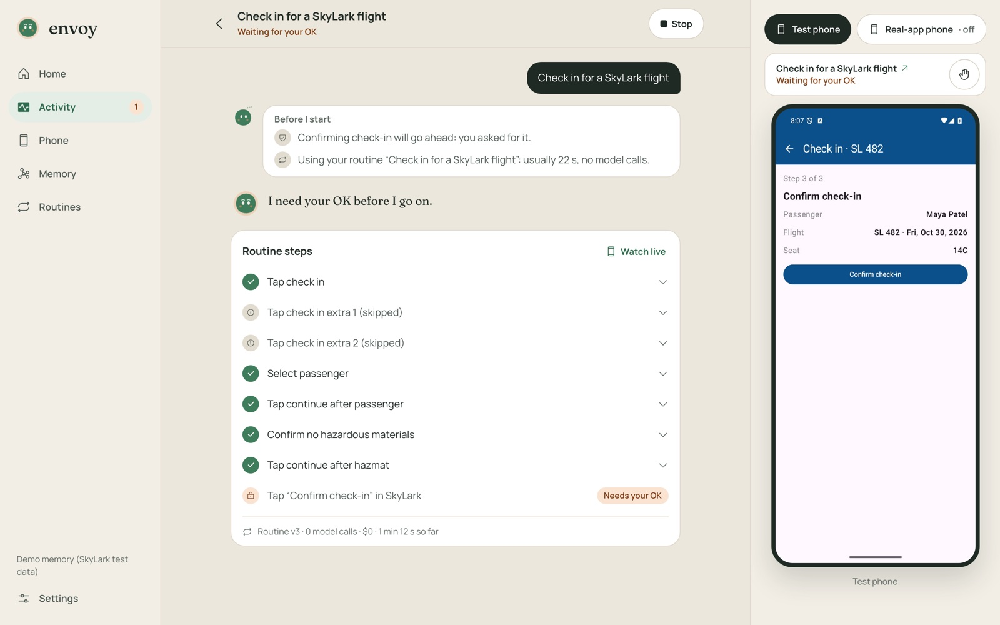
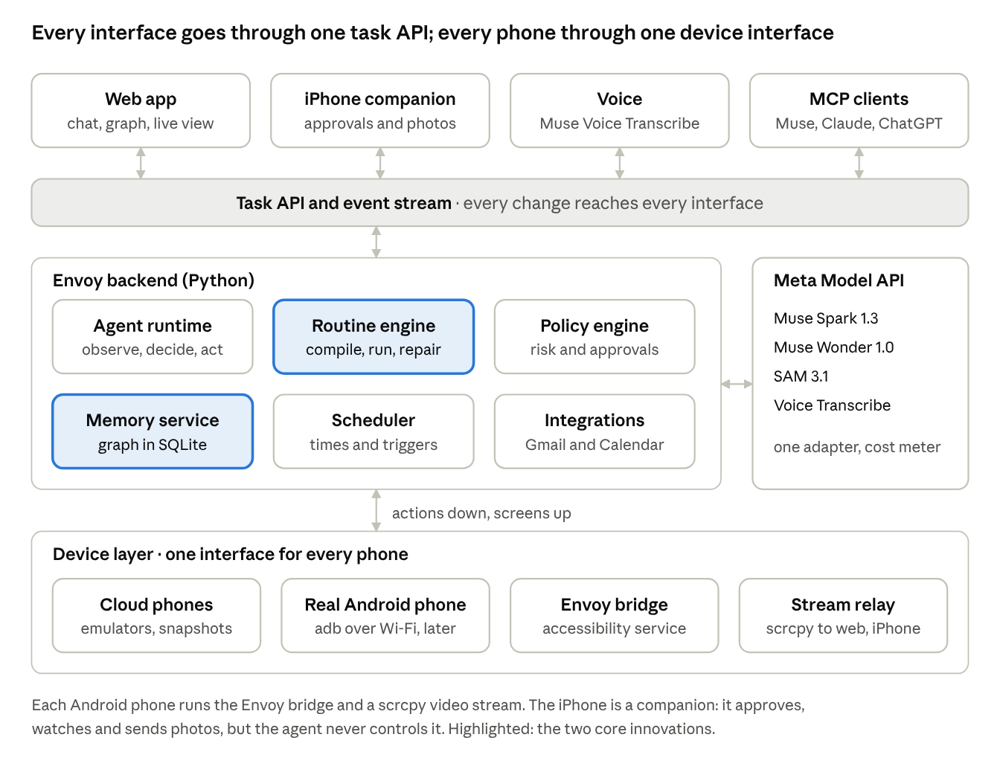
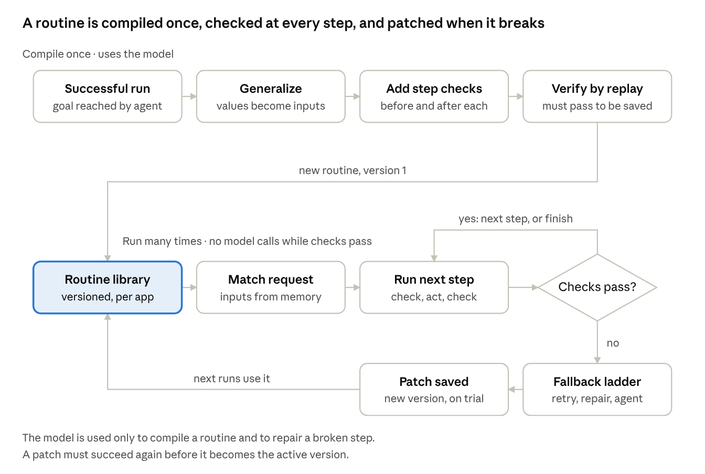
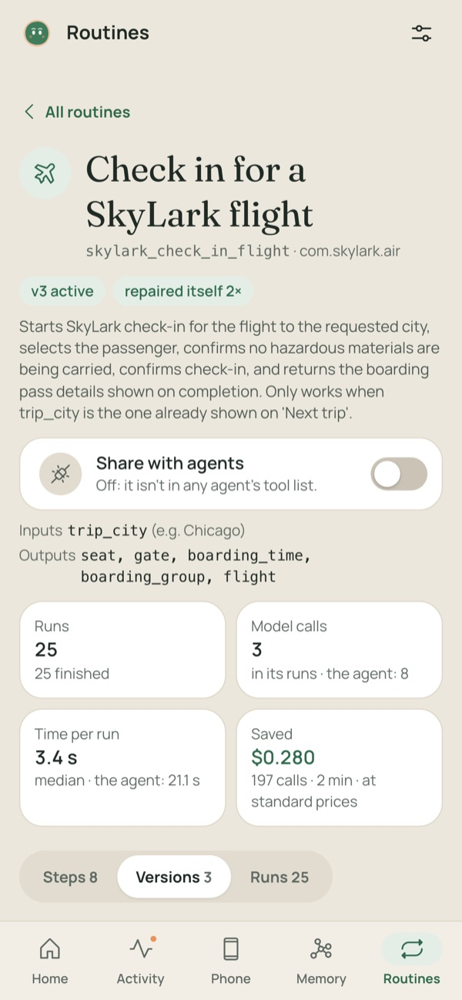
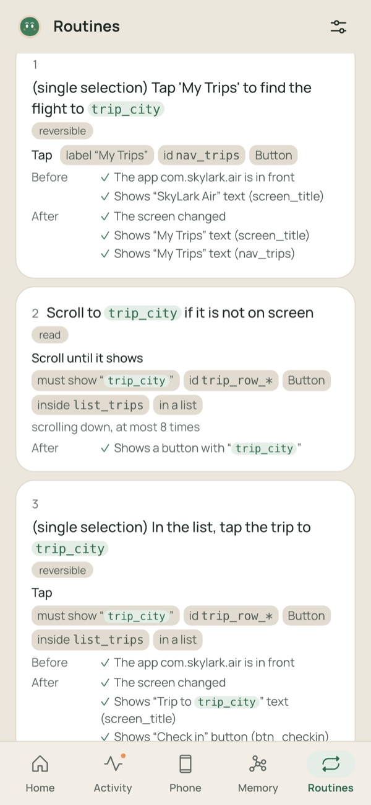
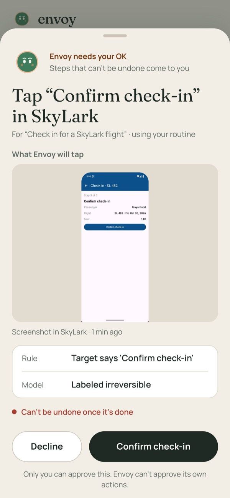

# Envoy

**Envoy gives AI agents a phone.**

Envoy is an MCP server that lets any AI agent work real Android apps: the things that only exist inside apps, like
posting a Reel with a song from Instagram's library, checking an Uber fare or checking in for a flight. It does a new
task with an agent on Meta's models, then **learns** it: one finished run is compiled into a routine, a small program
that checks every screen and replays with no model calls. When an app changes, the routine repairs itself, and falls back
to the agent when it can't. An irreversible step that an agent starts waits for the person's OK on their iPhone, and no
agent can give it.

**[Demo video (3 min)](https://www.youtube.com/watch?v=EIVoCPk8BME)** · [Showcase site](https://sanjeevexe.github.io/envoy/) ·
[What the models do](docs/models.md) · [All results](docs/results.md) · [Every feature](docs/features.md)



*A learned routine checking in for a flight in SkyLark, Envoy's own test app: each step checked as it runs, 0 model
calls, stopped at the one step that can't be undone.*

## How it works



Any MCP client can call Envoy. Meta's Muse (as a custom connector), Claude Code and a small agent on Muse Spark have, each
with its own key and only the tools the person gives it. Envoy runs the task on a phone it controls (an emulator, a
real Android phone over USB, or a cloud emulator) and tells the agent what happened.

**1. Acts.** On a task it hasn't learned, an agent loop plans, then makes one model call per step. It reads the screen's
accessibility tree as numbered elements and adds a screenshot only when it needs one (about 11% of steps on AndroidWorld).
On screens that are only pixels, SAM 3.1 proposes boxes and Spark picks one. Known pop-ups are dismissed and sign-ins
handed to the person without a model call, and every action is checked by code rules as well as the model's own risk
label.

**2. Learns.** A finished run, or a person's demonstration in teach mode, is compiled into a routine:



Code confirms the run worked and strips its dead ends. **Muse Wonder** generalizes it: which values are inputs another
request would change, which stay fixed, a generic intent for each step and the outputs to return. Code then binds those
inputs into the steps' targets, writes a check before and after every step from the screens the run saw, and replays the
routine before saving it. A compiled step finds its target by what it is, never by coordinates:

```yaml
- id: tap_trip_row
  intent: "Tap the trip row for {{trip_city}} in the list."
  action:
    tap: {resource_id: trip_row_*, text_has: "{{trip_city}}", kind: Button, parent: list_trips, in_list: true}
  post:
  - {screen_changed: true}
  - element_present: {resource_id: screen_title, text: "Trip to {{trip_city}}", kind: Text}
  - element_present: {resource_id: btn_checkin, text: Check in, kind: Button}
  risk: reversible
```

(One step of [`skylark_get_flight_gate`](data/routines/skylark_get_flight_gate/v1.yaml), shortened.)

A learned routine can be shared with agents, and it shows up in their tool list as a tool of its own, with typed inputs,
at their next `tools/list`.

**3. Repairs.** When a step stops matching the app, the routine tries the cheapest fix first: wait and retry, a relaxed
match or a scroll, the pop-up handler, then a local repair by the model, then the full agent, then the person. A repair
is saved as a new version on trial, and it becomes active only after a later run passes.

How each part works in detail: [`docs/models.md`](docs/models.md) and [`docs/technical-design.md`](docs/technical-design.md).

## What the models do

The rule: **models learn and repair; replay is code.**

| Model | What it does in Envoy |
| --- | --- |
| **Muse Wonder 1.0** | Compiles runs into routines; on the default `hybrid` profile, also plans and acts on new tasks and repairs broken steps |
| **Muse Spark 1.3** | Picks the routine for a request and fills its inputs; reads facts from screens, emails and photos into a sourced memory; picks targets on drawn screens |
| **SAM 3.1** | Proposes boxes on screens with no accessibility tree, like a canvas seat map |
| **Muse Voice Transcribe** | Dictation in the web app and on the iPhone |

Wonder's answer is checked by code and by a replay before a routine is saved, because its answers vary from run to run.
Every call goes through one adapter with a schema, effort and token cap per job, and is logged with its cost
([`backend/models/adapter.py`](backend/models/adapter.py)). The compiler's instructions to Wonder are
[`COMPILE_INSTRUCTIONS`](backend/models/prompts.py#L121).

## Results

From the final evaluation (10 suites on the `eval-final` tag, the default `hybrid` profile, Meta's standard tier) unless
noted. Scope, commits and every row: [`docs/results.md`](docs/results.md).

- **Real apps:** on 18 read-only workflows in apps Envoy didn't build (Amazon, Starbucks, DoorDash, Gmail, Maps, YouTube…),
  the agent's first run was right on 13 and 14 compiled into routines; 13 replayed right with 0 model calls, at a median
  4.88 s against the first run's 19.59 s.
- **Routines against simpler approaches** (SkyLark, our test app, 10 tasks on 4 layouts): routines 120/120 on the first
  try at a median 1 model call and 7.6 s; the agent alone 119/120 at 5 calls and 17.9 s; a fixed replay of the same taps
  38/120.
- **Asking again:** 90/90 repeat requests right at a median $0.0022, about 40 times cheaper than the first ($0.0869,
  the agent's run and the compile included).
- **When the app changes:** with SkyLark's layout changed on purpose 50 times, routines recovered 50/50, 44 with no model
  call.
- **Across phones:** routines compiled on an emulator ran 30/30 on a real Pixel 5 with no model calls, and, in a separate
  run, 48/48 on an emulator on Google Cloud.
- **Safety:** code rules alone caught 20/20 irreversible controls on saved screens; with instructions planted on screens,
  the agent followed them in 0 of 20 runs.
- **AndroidWorld** (Google's benchmark, 116 tasks in 20 apps, seed 30, pass@1, a separate run): 74/116 (63.8%), up from
  21 and then 57 through general agent changes. That's above every tree-only entry on the public, self-reported
  leaderboard (best 59.5%); Envoy reads the tree and adds a screenshot on about 11% of steps, so it isn't like for like
  ([details](docs/androidworld-results.md)).
- **Live posts** (separate runs): one clip went out as an Instagram Reel with a library song, a Story with a poll sticker, a TikTok with a
  sound and a YouTube Short, on test accounts, each started by an agent over MCP and approved on the iPhone.

## Envoy's app

The person's side of Envoy is a web app, on the Mac and on the iPhone's Home Screen: tasks with a live view of the phone,
the routine library, memory, and approvals.

<p>



</p>

*Left to right: a routine's page (its runs, model calls and time against the agent's); a compiled routine's steps, each
with its checks; and an approval on the iPhone, with the screen Envoy will act on and the rule that flagged it.*

It also has teach mode (do a task once through the live view and Envoy learns it), "Make it a routine" on any finished
task, Siri through an Apple Shortcut, offers and habits, and phone notifications as triggers
([every feature](docs/features.md)).

## Connect an agent

Envoy serves MCP at `/mcp` (Streamable HTTP) with 14 built-in tools: run a task or a routine, wait for it, post to
several apps in one request, search memory, send a file to the phone, list phones, read phone updates and more. Make a
key in Envoy's **Settings › Agents**, then, for Claude Code:

```bash
claude mcp add --transport http --scope user envoy http://127.0.0.1:8700/mcp --header "Authorization: Bearer $(pbpaste)"
```

Muse adds Envoy as a custom connector; the Spark agent and any other MCP client connect with a key
([`docs/agents.md`](docs/agents.md)).

## Run it

You need a Mac on Apple silicon, Homebrew's `openjdk@21`, the Android command-line tools, `uv`, Node, about 9 GB free and
a Meta Model API key. It runs on SkyLark, Envoy's own test app, so it needs no personal accounts.

```bash
source scripts/env.sh                                    # JAVA_HOME, ANDROID_HOME, PATH
(cd backend && uv sync)                                  # Python 3.13 environment
cp .env.example .env                                     # then set META_API_KEY and MCP_BEARER_TOKEN
```

Then the test phone, SkyLark and the web app, step by step: [`docs/getting-started.md`](docs/getting-started.md). A
fresh clone reached a checked-in flight in about 5 minutes in our test. The tests pass without a key
(`cd backend && uv run pytest -q`), and saved routines replay with no model calls.

## Limits, and what's next

- **A routine can still need the agent, or fail, in a live run.** Each routine's `index.json` lists every run.
- **Some apps refuse emulators,** like Target with its bot check. Envoy sends those to a real Android phone, asking
  first, and hands sign-ins and bot checks to the person.
- **It runs on a Mac today,** with the phone attached. The next step is a cloud phone per person, with MCP as the door for
  any agent; one cloud emulator ran Envoy's routines and a full learn-then-replay loop
  ([`docs/cloud.md`](docs/cloud.md)). Google Play doesn't allow publishing an app that acts through accessibility
  features, so any on-phone helper stays sideloaded.

## More

- **Docs:** [design](docs/technical-design.md) · [models](docs/models.md) · [features](docs/features.md) ·
  [results](docs/results.md) · [agents](docs/agents.md) · [getting started](docs/getting-started.md) ·
  [AndroidWorld](docs/androidworld-results.md) · [the showcase](docs/demo-showcase.md) · [notes on Meta's tools](docs/meta-feedback.md) ·
  [all docs](docs/README.md)
- **Layout:** `backend/` (Python 3.13: device layer, agent, routines, memory, models, the API and MCP server) ·
  `web/` (the web app, also the iPhone's Home Screen app) · `agents/` (the Spark agent) · `eval/` (task sets, runners,
  results) · `testapps/` (SkyLark) · `site/` (the showcase) · `scripts/` · `android/` (the on-phone banner)
- **Credits:** open-source components and their licenses are in [`THIRD_PARTY.md`](THIRD_PARTY.md), with what Envoy
  builds itself. **License:** MIT ([`LICENSE`](LICENSE)).
