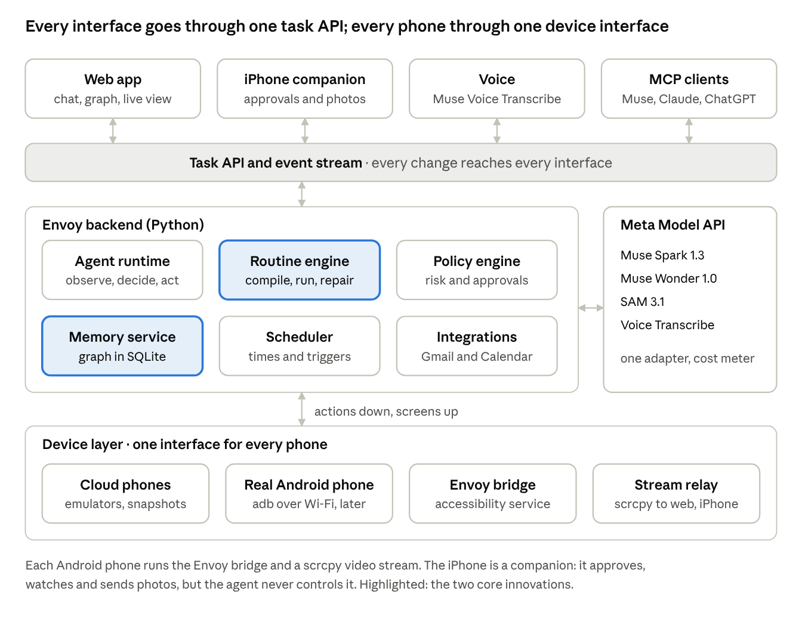
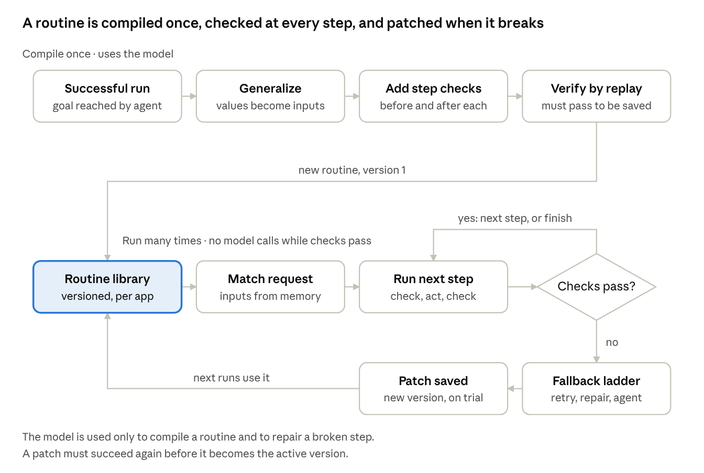
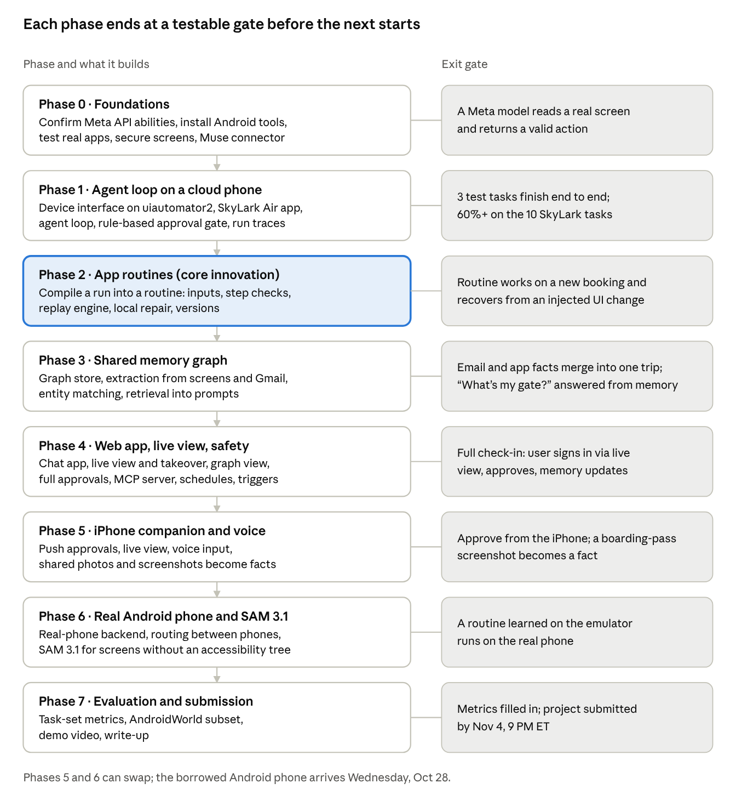

# Envoy — Technical Design

Oct 27, 2026 · Exported from the [live design doc](https://claude.ai/artifact/Sf51zMf4SMi5ZZmJabgPR5)

## Overview

**Envoy gives AI agents a phone layer: the ability to act inside any phone app, and to understand what those apps contain.** Agents can search the web, but the current state of a person's life (bookings, orders, balances, live updates) sits inside phone apps they cannot reach. Envoy runs emulated Android phones (on the laptop for this build, on cloud machines later) and, when needed, the user's own Android phone, lets a Muse-powered agent operate them the way a person would, and turns what it sees into one shared memory that every interface reads and writes.

**Pitch:** *Agents can search the web. Your phone knows your life.*

**What a phone layer gives an agent**

- **Reach:** finish tasks inside apps that have no website or API, instead of handing the user a link.
- **Context:** know the user's real bookings, orders, points and habits without asking.
- **Live state:** monitor gate changes, delivery status and expiring points, and act before being asked.
- **Cross-app answers:** compare prices across delivery or ride apps, or total spending across apps that never share data.

**What is actually new.** Operating phone apps with an agent has been done (Mobilerun, Gemini on Android, AGI Inc.). Envoy's contribution is making it dependable, cheap and useful over time:

1. **App routines.** One successful run is compiled into a reusable program with inputs, a check before and after every step, element-based targeting that works on any screen size, and self-repair that fixes only the broken step and saves the fix.
2. **A trustworthy shared memory.** Facts pulled from app screens, email and photos land in one graph. Each fact records where and when it was seen, newer facts replace stale ones, and the same trip seen in an email and an app becomes one entity.
3. **A device layer that routes between phones.** One interface over cloud emulators and real Android phones, with routines that run on either. The iPhone acts as a companion for approvals, the live view, voice and photos.

**Fit with the hackathon.** Indie track, theme *Push the Frontier*: Envoy gives Muse a capability it lacks today. As of October 2026, Muse acts through the web, partner connectors and (soon) Mac desktop apps; no source found shows it operating phone apps.

## Goals and non-goals

Envoy succeeds if a routine learned from one run works on new inputs, survives UI changes, and gets cheaper with each run, while every fact it remembers can be traced to its source.

**Goals**

1. An agent, driven by Meta models, completes multi-step tasks in real Android apps on a cloud emulator.
2. Successful runs become app routines that take inputs, verify every step, and repair themselves.
3. A shared memory graph, filled from app screens, Gmail, Calendar and iPhone photos, that every interface reads and writes in real time.
4. Users interact by web chat, voice, an MCP connector (for Muse or other assistants), and an iPhone companion app.
5. Users sign in themselves through a live view, approve irreversible actions, and control what is remembered.
6. A device layer ready for real Android phones, tested on a borrowed phone once available.

**Non-goals for this build**

- A fleet of cloud phones for many users. Envoy is built for one user, structured so each user could later get their own phone and graph.
- Operating apps on iOS. Apple does not allow it; the iPhone is a companion only.
- Payments, money transfers, or finance, health and messaging apps. These are blocked by default.
- Solving CAPTCHAs or bypassing app security checks. The agent hands control to the user instead.
- Billing, accounts, or a public launch.

**Success targets** (initial targets, to revise after the first measurements)

| Measure | Target | How it's measured |
| --- | --- | --- |
| First-run task success on the test task set | 70% or more | Agent completes the task with no human help besides sign-in and approvals |
| Routine success on new inputs | 85% or more | Run a learned routine with inputs it has not seen |
| Recovery after an injected UI change | 70% or more | Change the test app's layout, then rerun the routine |
| Model calls on a routine rerun vs the first run | 80% fewer | Count calls per run |
| Time per task on a routine rerun | Under 30 seconds for a 10-step task | Wall-clock time |
| Facts traceable to a source | 100% | Every fact links to its app screen, email or photo |
| Irreversible actions taken without approval | 0 | Audit log |

## Architecture

Envoy has four layers: interfaces, one Python backend, Meta's models, and a device layer. Every interface goes through a single task API, and every phone through a single device interface, so adding a new interface or a new kind of phone does not touch the core.



The routine engine and memory service (highlighted) are where the new work is; the rest makes them usable and safe.

### One task, end to end

The user says "check me in for my flight" to the iPhone companion:

1. **Voice to task.** Muse Voice Transcribe turns speech into text; the task API creates a task scoped to the airline app and trip memory.
2. **Context.** The memory service finds the next upcoming trip, with its confirmation code and the user's last name, each with its source.
3. **Routine match.** The routine engine finds `skylark_check_in` (version 3) and fills its inputs from memory. With no routine, the agent runtime runs the task step by step instead.
4. **Phone.** The device router leases the long-lived emulator, which is already signed in to the airline app.
5. **Run.** The executor runs each step with its checks, with no model calls while checks pass. Every step streams to the web app and iPhone.
6. **Approval.** "Confirm check-in" is irreversible, so the policy engine sends an approval notification to the iPhone; the user approves from the lock screen.
7. **Memory.** The routine's outputs (seat 14C, gate B12, boarding 5:30 AM) become facts linked to the trip and the app screen they came from; the graph view updates live and the calendar event is updated.
8. **Watching.** The scheduler adds a watcher that re-checks the gate every 15 minutes from 3 hours before departure, and tells the user if it changes.

If the app has changed since the routine was learned, step 5 climbs the fallback ladder, repairs the broken step, and saves a candidate version 4 (see App routines).

## Device layer

The agent never knows which phone it is using: one `Device` interface covers emulated phones and real Android phones. The first version drives both through uiautomator2; Envoy's own on-phone app (the **Envoy bridge**) replaces it only if measurements show it is needed. The iPhone is a companion, never a device the agent controls.

### The Device interface

```python
class Device(Protocol):
    id: str
    capabilities: Capabilities        # real_phone, has_sim, can_snapshot, screen size
    async def observe(self, screenshot: bool = False) -> ScreenState: ...
    async def act(self, action: Action) -> ActionResult: ...
    async def launch(self, package: str) -> None: ...
    async def wait_until_settled(self, timeout_s: float = 5) -> ScreenState: ...
    async def snapshot_save(self, name: str) -> None: ...   # emulators only
    async def snapshot_load(self, name: str) -> None: ...
    def video_stream(self) -> StreamHandle: ...             # for live view and screenshots
```

`ScreenState` holds the foreground app and screen, the accessibility tree as normalized JSON, a screen signature (a hash of the stable parts of the tree), an optional screenshot, and a timestamp.

### Envoy bridge (on every Android device)

Built only if Phase 1 shows that waiting for the screen to settle, or setting text, is unreliable on real apps. Phase 0 measured a uiautomator2 tree read at 31 ms and a full observation at about 70 ms, so read speed is no longer a reason to build it; and on a real phone (Phase 6, a Pixel 5 on Android 13) settling and set-text both held, so it is not built. If built, it is a small Kotlin accessibility service that:

- **Reads the screen** in-process as JSON (bounds, resource ID, text, description, class, clickable, editable, password flag) in roughly tens of milliseconds, against about 31 ms through uiautomator2's server (Phase 0) and 0.5 to 1 second for `uiautomator dump`.
- **Knows when the screen has settled,** because it receives accessibility events; no fixed sleeps.
- **Acts reliably:** click, set text (including non-English text and emoji, which `adb input text` cannot type), gestures, back and home.
- **Talks over a WebSocket** forwarded through `adb forward`, so the same code works over USB, Wi-Fi or in the cloud.

**uiautomator2** (MIT license) is the default from day one: it reads the tree and acts, and Envoy types any language and emoji through accessibility set-text. uiautomator2's own typing pastes through the clipboard, which would leak typed text, so it is never used, and submitting is a plain Enter key, because its IME action would switch the user's keyboard. Only one of uiautomator2 and the bridge can run at a time, since Android allows a single automation session. Mobilerun's Portal app is not reused: its license is AGPL-3.0.

### Screenshots and video

On emulators, the agent's screenshots come from the emulator's own gRPC screenshot call (enabled by `-grpc`), measured in Phase 0 at 6 ms for a raw frame (20 ms as PNG). Emulator taps also go through gRPC (under 1 ms, against about 150 ms through uiautomator2). On a real phone, Envoy's own Python client (Phase 6) is the only **scrcpy** client per device (the Apache-2.0 server, decoded on the Mac with PyAV); it serves the live view, and the agent takes screenshots from its latest frame (7 ms) rather than `adb screencap` (0.5 to 2.6 seconds on phones; 142 ms on the emulator). Either way, screenshots are the exception: the agent reads text first (see Agent runtime).

### Backend 1: cloud phones (emulators)

- **Image:** Android 15 or 16 (API 35/36) with Google Play, arm64, regular page size. Play images allow signing in to the Play Store; they cannot be rooted, which is fine.
- **Launch:** headless (`-no-window -no-audio -no-boot-anim -memory 4096 -grpc <port>`), 4 GB of guest RAM but about 7 GB of Mac memory each (measured), at most two at once on the 24 GB laptop, with the browser and other heavy apps closed. Always add -grpc-use-token: plain -grpc listens on every network interface with no auth. Also add -feature -WiFiPacketStream: netsim Wi-Fi crashed emulator 37.2.12 on snapshot load. On a new emulator, update Chrome and Android System WebView from the Play Store, because the image ships 2024 versions that break web sign-ins.
- **Snapshots for test apps:** test apps and evaluation restore a known snapshot before each task, which makes runs and routine verification repeatable. A restore takes about 1.8 s including reconnecting (Phase 0), and each snapshot is about 3.8 GB on disk, so old ones are pruned. After a restore, the backend re-establishes adb forwarding, the automation server and the video session.
- **No rollback for real apps:** real apps run on a long-lived emulator that is never restored to an old snapshot. Restoring an old signed-in session can replay expired sign-in tokens, which can get the session revoked or the account flagged. It always cold-boots with snapshots off and is shut down cleanly, because a hard kill can lose recent writes.
- **Pool:** a task leases a device for its duration; other tasks queue (see Leases and failures). Price comparisons would lease two emulators at once (stretch).
- **Later, in the cloud:** the same stack on a Google Cloud N2 machine with nested virtualization (about $0.19 per hour) or an AWS C8i machine (about $0.38 per hour), or Genymotion's hosted phones. For the hackathon, the emulators run on the laptop.

### Backend 2: a real Android phone

- Connected by wireless debugging (Android 11+): pair once, then connect over the same Wi-Fi. Campus Wi-Fi usually isolates devices from each other, so the fallback is USB, or the Mac joining the phone's hotspot.
- uiautomator2 (or the bridge, if built) is installed over adb. Android 13+ restricts accessibility access for sideloaded apps, so the bridge would be enabled once through the "Allow restricted settings" menu or an adb setting.
- On Samsung phones, Auto Blocker must be turned off.
- Secure sign-in and payment screens behave as described in Live view and sign-in.
- Google Play's policy forbids publishing an app that uses accessibility features to act autonomously, so any on-phone helper stays sideloaded. That is fine for the hackathon and is the main barrier to shipping this as a consumer product.

### Choosing which phone runs a task

| Situation | Phone used | Why |
| --- | --- | --- |
| Default | Cloud phone | Keeps the user's phone free; snapshots make runs repeatable |
| App refuses to run on an emulator (device integrity checks) | Real phone | Emulators never pass Google's device integrity check |
| App showed a bot check on an emulator, or the Play Store says the emulator isn't compatible | Real phone, from then on | Envoy sets "use my phone" for the app itself (Settings › Phones, with the reason; unticking undoes it) and offers to move the task |
| App the task names isn't installed on the emulator | Cloud phone, after installing it from the Play Store | Free apps only; a paid app asks through the approval flow and Envoy never pays |
| App allows only one signed-in device, and the user is signed in on their phone | Real phone | Avoids signing out the user's phone |
| Task needs the SIM or the phone's own number | Real phone | The emulator has no SIM |
| Two apps compared at once | Two cloud phones | Runs in parallel |
| No real phone connected | Cloud phone, or the user is told the app is unsupported | Never fails silently |

Before using the real phone, Envoy asks the user, shows a banner on the phone while it works, and pauses when the screen changes in a way its last action did not cause, or when the user presses Pause on the banner. Phase 6 builds it: the task waits on "Use your Android phone for this task?" (in the app and as an iPhone push; only the user's session answers, and no answer is never a yes); a small overlay app shows "Envoy is using this phone · Pause"; and a touch is told from Envoy's own input by getevent, which sees only the phone's physical input (everything Envoy does is injected). A touch, Pause, or another app coming to the front without an action of Envoy's hands the phone to the user like a takeover, checked before every action of the agent's; Resume on the phone or in the app gives it back. The user also picks the phone by saying "on my phone" or by setting an app to run there.

Apps that block emulators are data, not code: a starting list (`api/emulator_blocked.json`: Target, Uber Eats, common banking and payment apps) plus the ones Envoy finds itself. With no phone connected, Envoy says plainly that the app blocks emulators and needs a real Android phone, instead of trying the emulator (docs/app-routing-onboarding.md).

### iPhone companion

The iPhone runs Envoy's companion app (see Interfaces): approvals, the live view, voice, and photos. iOS does not allow one app to operate another, so the agent never controls the iPhone.

### Setting up this Mac

Done in Phase 0: the Android SDK, emulator, adb, scrcpy and cloudflared are installed, with an arm64 Java 21 (Homebrew) and Python 3.13 through uv. scripts/env.sh sets the paths.

## Agent runtime

The agent reads the screen as compact text, chooses one element-based action at a time as structured JSON, and attaches a screenshot only when text is not enough. That keeps each step cheap and makes every step recordable for routines.

### The loop

1. **Plan.** At the start of a task, Muse Spark 1.3 (higher reasoning effort) writes a short plan of subgoals and a **success check** that code can evaluate (for example, the text "You're checked in" is visible), using the request and relevant memory. It also gets the phone's date (goals say "tomorrow" or "this Thursday") and its apps by the names people use, and it knows that a button shown with one item (the card for the next trip, the last order) acts on that item only.
2. **Observe.** Wait until the screen settles, then read the accessibility tree and turn it into a compact list (below).
3. **Decide.** Muse Spark 1.3 (low reasoning effort) receives the cached system prompt and schemas, the plan with the current subgoal, the last 5 actions and their outcomes, relevant memory notes, and the current screen. It also gets what it kept from earlier screens of the task (REMEMBERED: text to copy, values to add up, copied word for word from the screen) and the phone's date. It returns one action as JSON, with the expected result and a risk label. Meta's structured output writes an object's keys in alphabetical order, whatever order the schema lists them in, so the fields are named for the order the model should decide them: what to keep, the reason, the expected result, then the action (its kind first) and the risk. Before an irreversible action the screen, or what it kept, must name the goal's own item (the flight, the person, the amount).
4. **Check policy.** The policy engine classifies the action's risk; an irreversible action waits for approval (see Safety). From Phase 1 this is a rule-based gate with a yes or no prompt in the terminal; the full approval flow arrives in Phase 4.
5. **Act** through the device interface.
6. **Verify.** Compare the new screen with the expected result. No visible change triggers a screenshot and a second try.
7. **Record** the step: before and after screens, action, reason, timing and cost.
8. **Finish.** When the model returns `done`, the runtime evaluates the success check in code. If it fails, `done` is rejected once and the model is told what is missing; the check was written before the app was seen, so a second `done` is accepted as "done, unverified". A task whose check cannot be evaluated is marked "done, unverified" too, and is never compiled into a routine without the user's confirmation. Facts are then extracted for memory (see Shared memory).

### How the screen is shown to the model

Only elements that matter are listed, each with a short number the model refers to:

```text
App: SkyLark Air · Screen: TripDetailsActivity · settled 220 ms
[1] Button "Back"
[2] Text "Trip to Chicago · Fri Oct 30"
[3] Text "SL 482 · ATL 6:10 AM → ORD 7:25 AM"
[4] Button "Check in" (id: btn_checkin) enabled
[5] Button "Change seat" (id: btn_seat)
[6] EditText "Add known traveler number" (empty)
(list scrolls down)
```

A screen of this size costs a few hundred tokens. A screenshot (about 3,200 tokens at the full 1080 by 2400 resolution, measured in Phase 0, so it is downscaled before sending) is attached only when the tree is sparse (Flutter, games, custom drawing), the last action had no visible effect, the model asks for one with a `look` action, or a repair is in progress.

When the on-screen keyboard is up, the screen says so under its first line (without it, the model pressed back "to close the keyboard" when none was open, and lost forms). An element's own long text (a note, an open file) is shown at length, up to 4,000 characters and 8,000 per screen; rows that merge their children's text stay at 120.

### Actions

| Action | Notes |
| --- | --- |
| `tap(el)`, `long_press(el)` | By element number; the runtime stores the element's full description for routines |
| `type(el, text, submit?)` | Uses accessibility set-text (through uiautomator2, or the bridge if built), so any language or emoji works; submit is a plain Enter key |
| `scroll(direction, el?)`, `swipe(...)` | Scrolls a list or the screen |
| `back`, `home`, `launch(app)` | Navigation; `launch` takes the app's name as people say it ("Simple Calendar Pro") or its package, matched against the phone's own app labels |
| `tap_point(x, y)` | Only for screens with no usable tree; coordinates come from visual grounding |
| `look` | Request a screenshot for the next step |
| `wait(seconds)` | For loading screens |
| `ask_user(question)` | Missing information |
| `handoff(reason)` | Sign-in, bot checks, anything the agent should not do |
| `done(result)` / `fail(reason)` | End of task |

The action is returned through Meta's structured output (`json_schema`), not tool calling. The Meta API only accepts automatic tool choice and does not guarantee tool arguments match their schema, while structured output is always constrained to the schema.

### Screens without an accessibility tree

For Flutter apps, games and custom-drawn screens:

1. Muse Spark's **visual grounding** returns points or boxes for a described element (on a 0 to 1000 grid), which become `tap_point` actions.
2. **SAM 3.1** proposes candidate regions from generic shape phrases ("square button", "icon"; it finds nothing for "seat" or "button"); they are numbered on the screenshot and the model picks one. Measured in Phase 6 on 52 targets (SkyLark's canvas seat map and real-app screens): the step model's own coordinates hit 37%, grounding 92%, SAM and a pick 75% (no wrong pick: it says none when its shapes miss a text button), and SAM first with grounding as the fallback 52 of 52, again on a fresh sample (grounding alone 49 of 52), at about 4 s and $0.007 per target. Envoy uses that combination: a tap at a point now names its target ("seat 21A"), and the runtime finds it on a full screenshot. Routines keep such a step as what it looks like plus its picture, find the picture again when the target is fixed, and look again (one SAM-then-grounding pass) when it depends on an input.
3. Meta also offers a native computer-use tool, but it acts in pixels for desktop-style actions. Envoy keeps element-based actions so routines stay portable, and uses that tool only as a comparison.

### Getting unstuck

- **Stuck detection:** the same screen signature three times, or an action loop, triggers a recovery. Lines that change by themselves (a clock, a timer) are masked first, so a ticking screen doesn't count as progress.
- **Recovery order:** go back one screen, replan the current subgoal, then ask the user.
- **Pop-ups:** a shared handler library dismisses common interruptions (permission prompts, rating requests, promos) without spending a model call.
- **Limits:** each task has a step limit and a cost limit; hitting either stops and reports.

### Several phones at once

As a stretch goal, for tasks like "cheapest delivery for this order," a lead agent splits the task into subtasks, runs each on its own emulator in parallel, and combines the results. This follows the lead-agent-and-subagents pattern Meta describes for Muse Spark, implemented by Envoy's own orchestrator.

### Traces

Every step is stored with its before and after screens, the action and its element description, the model's one-line reason, the time taken and the cost. Traces feed three things: the routine compiler, the evaluation suite, and the task view in the web app.

### Leases and failures

- **One lease per device,** with a first-in, first-out queue. Watchers skip a cycle if their device is busy.
- **Waiting for approval** releases the lease after 2 minutes; the task observes the screen again when it resumes.
- **Device errors** (adb offline, emulator crash, automation server stopped) reconnect with backoff up to 3 times; then the task fails with its trace saved.
- **Model calls** time out at 30 seconds and retry twice, backing off on rate limits. An invalid element number triggers a fresh observation and one retry.
- **Backend restarts** mark running tasks as failed rather than resuming them half-way.

## App routines

An app routine is a small program compiled from one successful agent run: it takes inputs, checks the screen before and after every step, finds buttons by what they are rather than where they were, and repairs only the step that breaks. Reruns need no model calls while every check passes.



The top row runs once per new task type; the bottom loop runs on every later request, and the model is called only when a check fails.

### What a routine contains

```yaml
routine: skylark_check_in
app: com.skylark.air            # test airline app
version: 3                      # v2 patched the "Continue" button
intent: "check in for a SkyLark flight"
inputs:
  confirmation_code: {type: code, from_memory: trip.confirmation_code}
  last_name:        {type: text, from_memory: user.last_name}
outputs: [seat, gate, boarding_time, boarding_pass]
steps:
  - id: open_trips
    intent: "Open My Trips"
    pre:  [app_foreground: com.skylark.air, element_present: {text: "My Trips"}]
    action: {tap: {resource_id: "nav_trips", text: "My Trips"}}
    post: [screen_has: {text: "Find a trip"}]
  - id: enter_code
    intent: "Enter the confirmation code"
    action: {type: {field: {hint: "Confirmation code"}, value: "{{confirmation_code}}"}}
    post: [field_equals: {hint: "Confirmation code", value: "{{confirmation_code}}"}]
  # ... 6 more steps ...
  - id: confirm
    intent: "Confirm check-in"
    risk: irreversible           # always asks for approval
    action: {tap: {text: "Check in", class: Button}}
    post: [screen_has: {text: "You're checked in"}]
    extract: {seat: {near: "Seat"}, gate: {near: "Gate"}}
```

- **Inputs** have types (text, code, date, phone, choice) and a hint for where memory can fill them, so "check me in" needs no further questions.
- **Locators** score several attributes of an element (resource ID, text, description, class, parent and sibling text) instead of coordinates. Real apps often obfuscate resource IDs (the Play Store's are all 0_resource_name_obfuscated), so text and descriptions carry most of the weight. A strict and a relaxed match threshold (0.80 and 0.60, tuned on SkyLark's layouts with and without IDs) separate a confident match from a changed element; a check, unlike a tap target, also needs text evidence and its element type, since an ID alone is shared across screens. An element repeated row after row with nothing of its own to tell it apart (a delete icon on every expense) also keeps its row's text, and a row chosen because it shows an input must show it. When an element has no usable attributes (icon-only buttons, Flutter apps), the locator stores a visual crop matched by image similarity, with Muse Spark's visual grounding as the fallback (SAM 3.1 is tested here too; see Agent runtime).
- **Checks** are code, not model judgments: app in front, element present or absent, text visible, field holds a value (read with get_text, since tree dumps garble emoji), screen signature similar enough. The signature is the app, the window title, and the sorted resource IDs and element types outside lists, ignoring all text and list contents, so it survives changing data. This avoids the failure seen in prior work where a model misreads whether a condition holds.
- **Outputs** pull values from screens (seat, gate) and write them to memory with their source. Extraction takes the text after the label in the same element (apps often merge them, as in "Seat 14C"), else the next element, else one Spark call with the outputs schema.
- **Risk** is recorded per step; an irreversible step always goes through approval, even in a routine.

**Lists** are handled by a `scroll_until(locator, direction, max_scrolls)` step rather than a recorded number of scrolls, since list contents change. The end of a list is reached when the tree stops changing after a scroll. The compiler converts recorded scrolls into this step.

### Compiling a routine

1. **Confirm success.** Only runs that reached the goal are compiled, judged by an explicit end signal ("You're checked in", a boarding pass visible) or by the user.
2. **Clean up.** Drop dead ends, back-tracks, retries and dismissed pop-ups. Pop-ups are handled by a shared handler library, not baked into routines.
3. **Generalize.** Any typed or selected value that equals a task input or a memory fact becomes an input slot. A list item chosen because it matched an input (the row for flight SL 482) becomes an input-based locator. A Meta model (Muse Wonder, for its stronger reasoning) names the inputs and decides which values stay fixed.
4. **Add checks.** For each step, the before and after accessibility trees are compared to write its checks automatically: which elements must be present before, and what must change after.
5. **Verify by replay.** The routine is replayed immediately from a reset snapshot with the same inputs, running through irreversible steps only on test apps (where restoring the snapshot undoes them) and stopping before them on real apps, and again with a second set of inputs where the test app allows. Only a routine that passes enters the library. Prior work found this verification step to be the single biggest source of improvement.

### Running a routine

A request is matched to a routine in four filters: the app, the intent pattern, similarity of descriptions, and a final model confirmation that also fills the inputs from the request and memory. A date or time the request only implies ("tomorrow", an end time from a start and a duration) is worked out in code from the phone's date, so the model never computes one. The executor then runs each step: wait for its before-checks (up to 5 seconds), find the element, act, wait for its after-checks. No model call is made while checks pass.

**When a check fails, the fallback ladder climbs one rung at a time:**

1. **Wait and retry,** for slow loading.
2. **Relaxed matching,** using the lower locator threshold.
3. **Known pop-ups** (permission prompts, ratings, promos) dismissed by the shared handler library. Permission prompts are denied unless the app's settings allow them.
4. **Local repair:** the model gets the step's intent, its checks and the current screen, and proposes actions that satisfy the after-check. Capped at 2 attempts per step and 5 per run.
5. **Full agent** takes over the rest of the task from the current screen.
6. **The user** is asked, through the live view.

### Patching and versions

- A successful local repair becomes a **candidate patch**: a new locator, an inserted step (a new "Continue" screen), or a removed one. It is saved as a new version marked "on trial."
- The candidate is replayed right away from a reset snapshot (test apps) or on the next run (real apps), and becomes active once that replay passes. If it fails, the routine rolls back to the previous version.
- If a routine fails more than half its recent runs, it is recompiled from a fresh full-agent run on the current version of the app.
- The routine library shows each version's changes with before and after screenshots, so the user can review or reject a patch.

### Working on any phone

Because locators use element attributes, not coordinates, the same routine runs on emulators of different screen sizes and on a real phone. Portability is tested cheaply before a real phone is available by running each routine on two emulator profiles (a small phone and a large phone). Phase 6: the 6 SkyLark routines compiled on a 1080 by 2400 emulator passed 18 of 18 on a 720 by 1280, 320 dpi one with no model calls, once a target below the fold is found by scrolling its list and an output scrolled out of view is read by scrolling back (neither needs a model call), and 12 of 12 through the real-phone code path.

### What is new, honestly

The closest prior work is **SkillDroid** (April 2026), which compiles successful phone-agent runs into parameterized templates with weighted element locators, checks the screen before each step, and fixes stuck steps with one model call. Earlier systems (MobileGPT, Agent Workflow Memory, Agent Skill Induction, Mobilerun's macros) cover parts of the idea. Envoy's additions, to the best of our search:

- **Checks after every step,** not just before, written as code.
- **Local repairs patched back into the routine,** with versions, a trial period and rollback, instead of recompiling the whole routine or patching nothing.
- **Tested portability** across screen sizes and from emulator to a real phone.
- **Routines connected to memory:** inputs filled from facts with sources, and outputs written back as new facts.

## Shared memory

Memory is a graph of typed entities whose facts each record their source, when they were seen, and how long they were true; it lives in one SQLite database behind one memory service that every interface uses. Users see it as an Obsidian-style map; the model sees it as short Markdown notes.

### Data model

| Table | Holds | Key fields |
| --- | --- | --- |
| `entities` | Things in the user's life | type, name, summary, pinned, user\_edited |
| `facts` | One attribute value of an entity at a time | entity, attribute, value, valid\_from, valid\_to, observed\_at, recorded\_at, retired\_at, source, confidence, author (extracted or user) |
| `edges` | Links between entities | from, relation, to, valid\_from, valid\_to, source, confidence |
| `sources` | Where a fact came from | kind (app screen, email, photo, calendar, routine run, user), reference (app and screen, email ID, photo ID), captured\_at, redacted snapshot, expires\_at |
| `events` | Append-only log of every change | time, kind, payload |

Keyword search uses SQLite's built-in full-text index, and natural keys (below) handle most matching. Similarity search (`sqlite-vec` with a small local embedding model) is added only if matching misses too often. Graph databases such as Neo4j (which Graphiti and mem0 rely on) are unnecessary for one user; the design borrows their ideas, not their storage.

**Entity types** are declared up front: Person, Trip, Flight, Reservation, Order, Item, Place, App, Account, Loyalty program, Subscription, Event, Preference, Note, Routine, Task. Notes are entities with a Markdown body and `[[links]]`, so a user note like "I always want an aisle seat" is a node like any other.

### Facts over time

Each fact has two timelines, an idea taken from Graphiti: when it was true in the world (`valid_from`, `valid_to`) and when Envoy learned or retired it (`recorded_at`, `retired_at`).

- **A new value replaces the old one.** When the airline app shows gate C14 and memory says B12, the B12 fact gets `valid_to` set to the new fact's start. Nothing is duplicated, and the history stays visible.
- **User edits win.** A fact written by the user in Envoy's own interfaces outranks extracted ones. Notes written by an AI assistant through MCP record that client as their author and rank like extracted facts. If a later observation contradicts it, the conflict is flagged for the user rather than silently overwritten.
- **Freshness rules per attribute:** a gate is fresh for 30 minutes while a trip is active, a delivery estimate for 10 minutes, a points balance for 7 days. Stale facts are shown with their age, and a watcher or routine can refresh them.
- **Confidence** combines the extraction model's confidence with how reliable the source is (an app screen ranks above an email, which ranks above a photo's OCR text).

### Getting facts in

| Source | How facts are extracted |
| --- | --- |
| App screens | At the end of a task and on routine `extract` steps, the redacted screen text goes to Muse Spark with the entity schemas (structured output). Every fact keeps a pointer to the screen and element it came from. |
| Gmail | Many confirmation emails carry schema.org markup (for example `FlightReservation`), which is parsed directly with no model call. Other emails go through the model. |
| Calendar | Events are read directly and linked to trips and reservations. |
| iPhone photos | Photos and screenshots the user shares (photo picker or the "Send to Envoy" Shortcut): text is read on the Mac with Apple's Vision framework, Muse Spark reads the image, every value must appear in that text, and the image is deleted (see Safety). Phase 5: 73 of 73 values right on 7 app screenshots, each merged into the known trip and flight. |
| Routine runs | Routine outputs (seat, gate, order total) are written directly as facts. |
| The user | Notes, edits and preferences from the graph view, chat or MCP. |

Apps blocked from memory are filtered out before extraction, and the redaction pass runs before anything is stored.

### Recognizing the same thing twice

The same trip in a confirmation email and in the airline app must become one entity.

1. **Exact keys first:** each type has natural keys (a flight's airline, number and date; a reservation's confirmation code; an order's merchant and order number).
2. **Candidates otherwise:** keyword and similarity search find likely matches.
3. **Model decides:** Muse Spark judges whether a candidate is the same entity. Facts are de-duplicated only within the same entity.
4. **Merges are reversible:** the user can split a wrongly merged entity in the graph view.

### Getting facts out (retrieval)

When a task starts or a question arrives:

1. Link mentions in the request to entities ("my flight" means the next upcoming Flight).
2. Collect those entities and their neighbors one or two links away.
3. Add keyword and similarity matches, combined by reciprocal rank fusion.
4. Keep only facts that are currently valid and allowed by the user's settings.
5. Render them as Markdown notes within a budget of about 2,000 tokens:

```markdown
## Trip: Chicago, Oct 30–Nov 2  [[Flight SL 482]] [[Hotel: The Drake]]
- Confirmation: KX7Q2M — email from SkyLark, Oct 12
- Seat: 14C — SkyLark app, today 9:41 AM
- Gate: C14 (was B12 until 9:41 AM) — SkyLark app, today 9:41 AM
- Boarding: 5:30 AM — SkyLark app, today 9:41 AM
- Preference: aisle seat — your note
```

The model sees where each fact came from and how old it is, so it can say "according to the airline app 5 minutes ago" and decide when to re-check.

### Staying in sync

The memory service is the only writer. Every change becomes an event, pushed over the same WebSocket stream as task updates, so the graph view, chat, iPhone and MCP clients all see the change at once. MCP tools read the same service.

### The graph view

- An interactive map of entities and links (Cytoscape.js), filterable by type and time, with the next 7 days highlighted.
- Clicking a node shows its facts, each with a source link (screenshot thumbnail, email, photo), its history, and edit and delete buttons.
- Notes are edited as Markdown, with `[[links]]` that create edges.
- Deleting a source deletes the facts that only it supports.

### What is new

Prior systems (Zep and Graphiti, mem0, Letta, A-MEM, GraphRAG) build memory from conversations and documents. None found takes phone app screens as a source with screen-level provenance, matches the same entity across email, app screens and photos, or lets user edits outrank extracted facts in a typed graph. Envoy also connects memory to routines: routine inputs come from facts, and routine outputs become new facts.

## Interfaces and integrations

Every interface talks to the same task API and memory service, and every change is pushed to all of them over one event stream. That is what keeps web, voice, iPhone and outside assistants in sync: none of them holds its own state.

| Interface | What the user does there | Built with |
| --- | --- | --- |
| Web app | Chat, watch tasks run, take over the phone, approve actions, browse and edit the memory graph, manage routines and permissions | React (Next.js, a static export served by the API), WebSocket event stream, live view over WebSocket (emulator frames; scrcpy for real phones) |
| Voice | Speak requests on the web or iPhone and hear short spoken replies | Meta's Muse Voice Transcribe for speech to text (public preview); spoken replies from the browser's or iPhone's built-in speech |
| iPhone companion | Approve actions from notifications, follow a running task, watch or take over the phone, send screenshots and photos in | The web app added to the Home Screen, over Tailscale Serve HTTPS on the user's tailnet; Web Push; a 6-digit pairing code |
| MCP server | Muse (if custom connectors accept it), Claude, ChatGPT or any MCP client can use Envoy's phone and memory | MCP Python SDK v2, Streamable HTTP, OAuth 2.1 |
| Gmail and Calendar | Envoy reads confirmation emails and adds events | Google APIs on a personal Google Cloud project |
| Scheduler | Tasks that run at a time or when something happens | Envoy's own small scheduler inside the backend |

### Tasks: the shared unit of work

Every request, from any interface, becomes a **task**: a goal, the interface it came from, its scope (allowed apps and memory areas), its status, its steps, and its approvals. The task API is the only way to start or change work. Every step, screenshot, approval request and memory change is published as an event, and every connected interface updates live.

### Web app

- **Chat** with the assistant, which is a Muse Spark model with Envoy's tools: run a task, run a routine, search memory, read email, manage calendar.
- **Task view:** the steps as they happen, each with its screenshot, the action taken, its risk level, and the model's one-line reason.
- **Live phone panel:** the phone's screen streamed in real time, with a "Take over" button (see Live view and sign-in).
- **Approvals inbox** for pending irreversible actions.
- **Memory graph view:** an Obsidian-style map of entities and links; click a node to see its facts, sources and history, edit it, or delete it.
- **Routines library:** each routine's steps, inputs, version history, success rate and cost per run.
- **Settings:** per-app permissions (act, remember, blocked), photo and message sources, standing approvals.

### Voice

The web app and iPhone stream microphone audio through the backend (which holds the API key) to Meta's **Muse Voice Transcribe** (real-time speech to text over WebSocket, in public preview since September 2026). The transcript goes into the message box for the user to check; once sent, it reaches the assistant like typed text, as the user's own words for the approval rules (source `voice`). Replies are short and spoken by the device's built-in speech engine, which keeps voice on Meta models and costs nothing extra. If Muse Voice Transcribe is unavailable or too slow, the fallback is the browser's own speech recognition in Chrome. Phase 5: voice is dictation. The user taps the mic, taps stop, and the transcript lands in the message box to check and send; sending on release had started a check-in the moment the user let go. Each dictation is one Transcribe session (24 kHz PCM from an AudioWorklet; audio is buffered while the session connects). The final text arrives about 70 to 300 ms after stopping, on the user's Mac and iPhone alike, at $0.18 per audio hour. Transcribe closes a stream that falls behind real time, so the relay pads silence whenever the browser's audio stalls.

### iPhone companion app

The companion is the web app added to the iPhone's Home Screen, which needs no Apple Developer account. (TestFlight is not a free option: it requires the paid $99 program.) If web push approvals or photo sharing don't work well enough in practice, the fallback is paying for the Apple Developer Program and building the native SwiftUI app, which adds lock-screen Live Activities and on-device text reading. Phase 5 built it: the app reaches the Mac through Tailscale Serve, a real certificate on a private `*.ts.net` name (HTTPS on :8443) reachable only by the user's devices, and the API answers only to its own names. The Home Screen app keeps its own cookies, apart from Safari, so the user signs in by typing a 6-digit pairing code from the Mac inside the installed app (single use, 5 minutes, 5 tries); each device gets its own revocable session, and the Share Sheet shortcut gets a token that can only upload images.

- **Approvals:** web push notifications, which iOS supports for Home Screen web apps from iOS 16.4. Web notifications have no action buttons, so tapping one opens the approval page, where the user approves or declines. A push never carries the approval's nonce, and it is sent only when Envoy actually asks (an approval the user's request already gave doesn't push). Phase 5: delivered 0.7 to 2.3 s after sending (4 of 5 pushes under 1.2 s).
- **Running task:** the app shows the current step and screenshot; key moments (approval needed, task done, task failed) also send a notification. Lock-screen Live Activities need a native app and are left out.
- **Live view:** the same stream as the web app (the emulator's gRPC frames; scrcpy for real phones), with touch forwarded to the phone: tap, swipe, long press, and typing through the iPhone's keyboard. Phase 5: 66 to 115 ms from capture to the iPhone's screen over the tailnet.
- **Voice:** dictation: tap the mic, tap stop, check the words in the message box and send; the audio streams through the backend to Muse Voice Transcribe.
- **Screenshots and photos:** the user picks photos or screenshots in the app, or uses a free "Send to Envoy" shortcut from the iOS share sheet. The image goes to the server, text is read on the Mac (Apple's Vision framework), Muse Spark extracts facts checked against that text, and the image is deleted once its facts are saved. The app cannot scan the photo library on its own.
- **Sign-in codes:** iOS does not let apps read texts. An optional Shortcuts automation ("when a message containing 'code' arrives, send it to Envoy") can forward codes and works without any app. Tested in Phase 5: it forwarded a message about 2 s after it arrived, with the phone locked, once the shortcut had been run by hand to grant its network permission. The fallback is the user typing the code in the live view.

### MCP server

Envoy exposes its abilities as an MCP server (Streamable HTTP and stateless, serving spec versions 2026-07-28 and 2025-11-25, the version Muse's connector uses; bearer token, plus OAuth 2.1 if a client requires it), so any assistant that accepts remote MCP servers can use them.

| Tool | Purpose |
| --- | --- |
| `run_task(goal, apps?, deadline?)` | Start a task; returns a task ID |
| `get_task(task_id)` | Status, steps so far, and pending approvals with a link the user opens to approve |
| `list_routines()` / `run_routine(name, inputs)` | Use learned routines directly |
| `memory_search(query)` | Search the memory graph; returns facts with sources |
| `memory_get(entity_id)` | One entity, its facts and links |
| `memory_note(text, links?)` | Add a note; recorded with the client as its author |

There is deliberately no approve tool: an assistant must never approve its own irreversible action (see Safety). Approval links must never approve on a page load, because Muse's link preview fetches them automatically (Phase 0). For the hackathon the server requires a bearer token, since `run_task` drives a phone; OAuth 2.1 is added if a client requires it.

### Path into Muse

Envoy is built to plug into the real Muse app, but it never depends on that: three routes are tried in parallel, and the demo uses the best one that works.

| Route | What it takes | Status |
| --- | --- | --- |
| 1. Envoy's own assistant, built on Muse Spark | Nothing beyond the Meta API | Always works; the fallback demo |
| 2. Muse custom connector | A public HTTPS address for the MCP server, a bearer token, and asking the Muse app to connect to it | Verified in Phase 0: Muse's free tier added Envoy as a custom connector, called both tools and showed the approval link. Phase 5: the Muse app ran a real check-in through Envoy's own MCP server, waited for the user's approval on Envoy's page and reported the seat and gate |
| 3. Listed connector or Meta AI Connectors preview | A submission to the Muse Connector Platform review, and joining the Meta AI Connectors waitlist | Apply on day one; unlikely to clear review before Nov 4 |

**Phase 0 connector test (about 2 hours):**

1. Run a stub MCP server with two tools, `memory_search` (returns a fake trip) and `run_task` (only logs the request), behind Tailscale Funnel or a Cloudflare Tunnel with a bearer token.
2. In the Muse app's free tier, ask Muse to add a custom connector for that address and token, then ask "what's my gate?" and "check me in for my flight."
3. Record what happens: whether it connects, calls the tools, passes the right arguments, and shows the approval link `get_task` returns.
4. If MCP fails but Muse can call ordinary web APIs, expose the same tools as a small REST API with an OpenAPI description and try again.
5. Ask Meta's team at kickoff or in Discord office hours whether hackathon builders can get connector access.

**Decision after the test.** Route 2 works (Phase 0), so the demo opens in the real Muse app ("check me in for my flight") and Envoy does the phone work, with the approval on the user's iPhone. If it doesn't, the demo uses Envoy's own Muse Spark assistant, and the pitch shows the standard MCP server that Muse can connect to once connector access opens.

**Safety is unchanged:** Muse is an AI client like any other. It gets no approve tool, approvals still come only from Envoy's own screens, it sees only what tools return, and its token can be revoked at any time. Its approval links point at the user's tailnet, so link previews can't fetch them.

### Gmail and Calendar

- A personal Google Cloud project in testing mode, with a dedicated test Google account as its only user. `gmail.readonly` is a restricted scope, but personal use under 100 users is exempt from Google's verification; the user sees an "unverified app" warning once.
- In testing mode, sign-in tokens expire every 7 days, so the design includes a one-click re-connect.
- New mail is found by polling Gmail's history every 2 minutes. Gmail push notifications (Pub/Sub) are a later upgrade, since they need a public endpoint and topic permissions.
- Confirmation emails (flights, orders, reservations) go through extraction into memory.
- Calendar events are read to link trips and reservations; writing events (`calendar.events` scope) is a stretch goal.

### Scheduled and event-triggered tasks

APScheduler runs inside the backend. Three kinds of trigger create tasks:

1. **Time:** fixed ("every Sunday at 9 AM, clip coupons") or derived from memory ("24 hours before any flight's departure, check in"). Derived triggers update when the fact changes, such as a delayed departure.
2. **Events:** a new email matching a pattern, a new screenshot from the iPhone, or a fact changing in memory.
3. **Watchers:** re-run a read-only routine every N minutes while something is active (for example, check the airline app for gate changes from 3 hours before departure until boarding).

Event triggers can only start a routine or task template the user created in advance; the triggering email or screenshot supplies typed inputs, never the goal or the plan. Triggered tasks follow the same policy as user-started ones: if a step is irreversible and no standing approval covers it, the user gets an approval request.

## Live view and sign-in

The phone's screen streams to the browser and iPhone as video, and a "Take over" button hands the phone to the user with the agent paused and nothing logged. This is how users sign in without Envoy ever seeing a password.

### Streaming

- **On the phone:** the scrcpy server encodes the screen as H.264 (scrcpy reports 35 to 70 ms latency).
- **Relay:** Envoy's own scrcpy client in the API (Phase 6), instead of the planned Node service using the Tango libraries (`@yume-chan/adb`, `@yume-chan/adb-scrcpy`, MIT license) reads the stream over adb, decodes it on the Mac (PyAV, FFmpeg) and sends JPEG frames over the same WebSocket as the emulators' gRPC frames, with the same touch input and latency measurement.
- **In the browser:** frames are drawn on a canvas; decoding with WebCodecs (`@yume-chan/scrcpy-decoder-webcodecs`) is no longer needed.
- **On the iPhone:** the same page inside the companion app's web view. The same frames as on the Mac.
- **HTTPS is required** for WebCodecs, Web Push and the microphone, so the iPhone reaches the Mac through Tailscale Serve (HTTPS inside the private network), and a Cloudflare Tunnel gives the MCP server its public address only while Muse needs it (the tunnel reaches `/mcp` and nothing else).
- **Target:** under 150 ms from the phone to the screen on the same network. Phase 6, on an emulator standing in for the phone: a tap shows as a changed frame in 62 ms, and that frame reaches the page 12 ms after decoding.

Google's emulator WebRTC stack was considered, but it works only for emulators and its container scripts run only on Linux x86 machines. On emulators, Phase 4 streams the emulator's own gRPC frames instead (JPEG over the API's WebSocket, 18 to 60 ms locally), because scrcpy shows secure sign-in screens black and the gRPC frames don't; scrcpy and the relay are for real phones.

### Take over and hand back

1. The user presses **Take over**, or the agent requests it with a `handoff` action (a sign-in screen, a bot check, a question it cannot answer).
2. The device lease moves to the user. The agent's loop is paused, screenshots for the model stop, and the user's touches and keystrokes travel as scrcpy control messages straight to the phone, bypassing logs and models.
3. A banner shows "You are in control" on every interface.
4. The user presses **Hand back**. The agent observes the screen fresh, checks whether the blocking step is done (for example, the app now shows the account screen), and continues.

### Sign-in

- **First use of an app:** the agent opens it and hands off at the sign-in screen. Afterward, the long-lived emulator stays signed in (test apps are saved in a snapshot instead).
- **Secure screens.** Screens marked secure (`FLAG_SECURE`), common for sign-in and payment, are black in scrcpy video and adb screencap on emulators and real phones, but not in the emulator's own window or its gRPC screenshot (Phase 0). Their accessibility tree is usually readable, but not always: Amazon's sign-in WebView exposes nothing. Many native sign-in screens are not marked secure at all (Target, Chipotle, DoorDash, Google). The agent hands off when the window is marked secure, a password field appears, or the screen matches a known sign-in pattern (an email or phone field next to Sign in or Continue). It takes no screenshots while the window is secure. On an emulator, the user then signs in through the emulator's own window on the laptop, or through the emulator's gRPC screen stream. Phase 0 showed that stream does capture secure screens, so a remote sign-in from the web app or iPhone works on emulators. On a real phone, the user signs in on the phone itself.
- **Expired sessions:** the agent detects a sign-in screen at any point and hands off again.

### Sign-in codes

The emulator has no SIM, so text-message codes arrive on the user's iPhone. Three ways to finish a sign-in, in order of preference:

1. **The user types the code** in the live view (always available).
2. **An iPhone Shortcuts automation** forwards messages containing "code" to Envoy, and the agent types it. Phase 5 tested it on a locked phone: it works, once the shortcut has been run by hand to grant its network permission.
3. **A real Android phone** with the bridge can read the code from the notification. Android 15 hides codes from untrusted notification readers, so this may need the agent to read the notification on screen instead.

For testing, codes can be injected into the emulator with `adb emu sms send`. Codes are used once and never stored (see Safety).

## Safety, privacy and permissions

The agent never takes an irreversible action without the user's approval, never sees a password, and never acts in or remembers sensitive apps unless the user opts in. These rules live in one **policy engine** that every action passes through, including actions replayed from routines.

### Classifying every action before it runs

Each proposed action gets a risk level: **read** (scroll, open, look), **reversible** (add to cart, fill a field), or **irreversible** (pay, place order, submit, send, confirm check-in, cancel, delete). Three independent signals vote, and any one flagging "irreversible" pauses the run:

1. **Rules:** the target element's text and resource ID match a list such as Pay, Place order, Confirm, Submit, Send, Delete, Cancel booking, in several languages.
2. **Screen context:** the screen looks like a checkout, payment or final-confirmation step (price totals, card fields, "review your order").
3. **Model judgment:** the step model labels each action's risk as part of its output. Meta reports that Muse Spark 1.3 is better calibrated on irreversible actions, so it is used for this label.

A `type` action that also submits (presses Enter) is classified by the screen's main button and the screen-context signal, not by the text field it targets, since pressing Enter can place an order or send a message.

### Approvals

- An approval request shows a screenshot, a one-line description ("Place order at Chipotle, $14.82"), and the amount if any. It goes to the iPhone as an actionable push notification and to the web app.
- The approval is bound to the exact screen it was shown for: the app's own elements, not the keyboard or status bar, which come and go. If the screen changes before the tap (price changed, new pop-up), the agent asks again.
- No answer within a time limit means the task is paused, never auto-approved.
- **The user chooses when Envoy asks**, for everything, per app or per routine: *always ask*; *ask unless I asked for it* (the default: "check me in" is the OK to tap "Confirm check-in" for that trip, and Envoy says so afterwards); or, for a routine, *never ask* (a standing approval, e.g. "check in for my flights automatically", which also covers a trigger starting it). Envoy still asks whenever money is involved, when the step isn't what was asked (the button's own words must be in the request), when the details differ (names, codes and numbers in the request must be on the screen or in the task's inputs), and when the request came from a trigger, an email or an AI client rather than the user, unless a standing approval covers the routine. These are rules, not model judgments.

**Only a person can approve.** Approvals are accepted only from Envoy's own approval screen or iPhone notification, never through MCP or the chat assistant's tools, so no AI (including the one running the task) can approve its own action.

### Sign-in and credentials

- When a screen contains a password field (the accessibility tree marks password fields), the agent stops and hands control to the user through the live view.
- During a takeover the agent is paused, screenshots stop, and the user's input goes straight to the phone without being logged or shown to any model.
- Sign-in codes from text messages (real Android phone only) are read only while a sign-in is in progress, used once, and never stored.

### Blocked app categories

| Category | Agent can operate | Remembered | User can override |
| --- | --- | --- | --- |
| Finance and banking, payments, crypto | No | No | Memory only (for example, balances), never actions that move money |
| Health and pharmacy | No | No | Yes, per app |
| Messaging and social DMs | No | No | Yes, per app and per conversation |
| Password managers and authenticators | No | No | No |
| Government and ID | No | No | Yes, per app |
| Everything else (shopping, food, travel, rides) | Yes | Yes | Can turn off per app |

Categories come from the app's Play Store category and a maintained list of package names, and the user can change any app's setting.

### Redaction before anything is stored

Before a screen, log line or fact is saved, a redaction pass removes password-field contents, card numbers (detected by pattern and checksum), sign-in codes, and government ID numbers. Screens that Android marks as secure (`FLAG_SECURE`) appear black in scrcpy video and adb screencap but not in emulator gRPC screenshots. So the agent takes no screenshots while such a window is in front, and treats it as a hand-off point (see Live view and sign-in).

### Photos and messages

- **Photos:** off by default. The default scope is screenshots only, not the whole camera roll. Only photos the user picks or shares are sent; text is read on the Mac, lines with card numbers, codes or ID numbers are blacked out in the copy Muse Spark sees, and the image is deleted once its facts are saved (or when nothing is found).
- **Messages:** not part of this build. A later Android companion could read business texts the same way; personal conversations would stay excluded unless the user includes them.
- Every resulting fact links back to its source and can be deleted.

### Untrusted content and prompt injection

App screens, emails, notifications and web pages are treated as data, never as instructions.

- The plan comes only from the user's request. Text from screens is passed to the model inside clearly marked data sections.
- Each task gets a scope: the apps and memory areas it may touch. Leaving that scope (opening an unrelated app, sending data somewhere new) pauses the run for approval.
- The irreversible-action gate holds even if a screen tricks the model, because the rule and screen-context signals don't depend on the model.

### Retention, storage and control

- Full screenshots and raw screen dumps are deleted after 7 days. The redacted screen text and a small redacted thumbnail are kept as long as any fact cites them, so every fact stays traceable.
- Every action is written to an audit log: time, device, app, action, risk level, approval.
- The database and emulator snapshots (which hold signed-in sessions) live on the Mac's FileVault-encrypted disk. API keys live in the keychain or environment, never in code and never on the web or iPhone clients.
- A stop button on every interface halts the agent and disconnects it from the phone immediately.
- Automating some apps may break their terms of service. The test apps are built by us; real-app use is limited to the user's own accounts and noted as a risk.

## Models and cost

Every model call goes through Meta's Model API, mostly to Muse Spark 1.3; as measured in Phase 0, an agent step at low effort costs about $0.001 and takes about 0.9 s, so a first run of a task costs about 4 cents and a routine rerun well under 1 cent, so about $200 of credits covers development and evaluation with room to spare. The API is compatible with the OpenAI SDK, and Meta recommends its Responses API for agents.

### Which model does what

| Job | Model | Settings | Price (per million tokens, input / output) |
| --- | --- | --- | --- |
| Each agent step, including its risk label | `muse-spark-1.3` | Low reasoning effort, structured output | $1.25 / $4.25 (cached input $0.15) |
| Plans, local repairs, entity matching | `muse-spark-1.3` | Medium to high effort | Same |
| Compiling routines, hard merges (Spark at high effort if Wonder is not covered by credits) | `muse-wonder-1.0` (preview) | High effort | $4.00 / $20.00 |
| Elements on screens with no tree | `muse-spark-1.3` visual grounding | Points or boxes | Same as Spark |
| UI region segmentation (experiment) | `sam-3.1` | Specific noun phrases (toggle switch, search bar, icon); generic ones such as button find nothing | $2.50 per 1,000 images |
| Voice input | `muse-voice-transcribe-1.0` | Real-time, turn detection | $0.18 per audio hour |
| Spoken replies | Device speech engines | None | Free (Meta has no text-to-speech API) |

**Optional Meta models:** Muse Glimmer (30B open weights, Apache 2.0) could take cheap steps like routine matching if partner GPU credits come through; it needs about 18 to 20 GB at 4-bit, too much next to two emulators on this laptop. Muse Image is not needed for the core product.

**Contributor tier:** Spark costs $0.10 / $0.20 per million tokens in Meta's Contributor tier, but Meta may train on what is sent. It is a separate model ID (muse-spark-1.3-contributor) limited to 150 requests per minute. It is used only for evaluation runs on our own test apps, never for the user's real screens, emails or photos.

### Estimated cost per task

These are estimates from Meta's published prices, to be replaced with measured numbers in Phase 0.

| Run type | What is sent | Estimated cost |
| --- | --- | --- |
| One agent step | Measured: about 1,900 cached prompt tokens, a few hundred new tokens, and 144 output tokens, 88 of them reasoning (low effort) | About $0.001 (measured), plus about $0.004 with a full-size screenshot |
| First run, 15 steps | Plan, 15 steps (5 with screenshots), fact extraction | About $0.04 |
| Compiling a routine | Full trace to Muse Wonder, once per task type | About $0.18 |
| Routine rerun | One matching call; no model calls while checks pass | About $0.003 |
| Rerun with one local repair | Matching plus one repair call | About $0.02 |
| One minute of voice | Transcription | About $0.003 |

At standard prices, $200 covers roughly 2,000 first runs, and development (about 1,000 agent runs and 100 compiles) would cost about $110 before evaluation and retries. So development and evaluation on our own test apps use the Contributor tier, bringing that to roughly $30; real apps and real user data always use the standard tier. Reported cost metrics are computed from token counts at standard prices, whatever tier was billed. Output tokens per step (500 here) are measured in Phase 0, since reasoning may use more.

### Keeping costs down

- **Text first:** the accessibility tree instead of screenshots wherever possible.
- **Stable prompt prefix:** system prompt, schemas and plan come first and are cached (Meta's prefix cache, with `prompt_cache_key` as a routing hint and prompt_cache_retention set to 24h. Caching is automatic and hit 19 of 20 repeated calls in Phase 0, screenshots included).
- **Low reasoning effort** for routine steps; reasoning cannot be turned off and is billed as output.
- **Routines** remove model calls from repeat tasks, which is both the product's main claim and its main saving.
- **A cost meter** records tokens and dollars per call, task and routine, with a daily cap that pauses work when reached.

### One adapter for every model call

All calls go through one module that sets the model, effort and schema per job, logs cost, retries on rate limits (Spark allows 3,000 requests per minute per team), and can switch a job to another model with one setting. This protects the build if a model is slower or weaker than expected.

## Tech stack and repository

Python runs the agent and memory, a small Node service relays video, React is the web app, Kotlin is used for the on-phone bridge and test apps, and Swift is used for the iPhone; everything lives in one repository.

| Part | Technology | Notes |
| --- | --- | --- |
| Backend | Python 3.13 (managed with `uv`), FastAPI, asyncio, Pydantic | Task API, agent runtime, routine engine, policy engine, memory service, scheduler |
| Model calls | OpenAI Python SDK pointed at `https://api.meta.ai/v1` | Responses API, structured output |
| Phone control | `adbutils` (MIT), Envoy bridge over WebSocket; `uiautomator2` (MIT) for the first days |  |
| Frames for the agent | PyAV decoding the scrcpy stream |  |
| Storage | SQLite with FTS5 and `sqlite-vec` | One file on the FileVault-encrypted disk; embeddings only if needed |
| Scheduler | Envoy's own, inside FastAPI (Phase 4) | Times derived from memory are recomputed on every check; Temporal or Inngest only if durable long waits become necessary |
| MCP server | MCP Python SDK v2, Streamable HTTP, OAuth 2.1 | Needs a public HTTPS address for outside assistants |
| Video relay | Node with TypeScript, `@yume-chan/adb` and `@yume-chan/adb-scrcpy` | Real phones (Phase 6); emulators stream gRPC frames from the API. Phase 6 replaced it with Envoy's own scrcpy client in Python (frames decoded with PyAV), pinned to scrcpy server 5.0.1 |
| Web app | Next.js, React, TypeScript, Tailwind; Cytoscape.js for the graph; WebCodecs decoder |  |
| Envoy bridge | Kotlin accessibility service | Sideloaded over adb |
| Test apps | Kotlin with Jetpack Compose | SkyLark Air (airline) and a small shop app, each with switchable layout versions to inject UI changes |
| iPhone companion | The web app on the Home Screen: Web Push, microphone, photo picker; iOS Shortcuts for sharing and codes | No Apple account needed; native SwiftUI optional later |
| Gmail and Calendar | Google API Python client, Pub/Sub push | Personal Google Cloud project |
| Dev setup | Android SDK command-line tools and emulator, arm64 Java 21, scrcpy, Tailscale or mkcert | Muse Code can help write code |

```text
envoy/
  backend/
    api/            # task API, WebSocket event stream, auth
    agent/          # loop, planner, screen formatter, actions, traces
    routines/       # compiler, locators, checks, executor, repair, versions
    memory/         # schema, extraction, entity matching, retrieval, renderer
    policy/         # risk classifier, approvals, app categories, redaction
    devices/        # Device interface, emulator and phone backends, pool, router
    models/         # Meta API adapter, prompts, schemas, cost meter
    integrations/   # Gmail, Calendar, scheduler, triggers
    mcp_server/     # MCP server tools (not mcp/, which would shadow the SDK)
  bridge-android/   # Kotlin accessibility service (Envoy bridge)
  relay/            # Node scrcpy video relay
  web/              # Next.js app
  ios/              # optional native companion (later)
  testapps/         # SkyLark Air, shop app (with layout variants)
  eval/             # task sets, injected UI changes, runners, reports
```

### Test apps

SkyLark Air comes first and is time-boxed to about one day; the shop app is a stretch goal. It needs:

- **Element IDs:** the Compose root sets `testTagsAsResourceId = true` and key elements carry test tags, so locators like `btn_checkin` exist. Most real apps lack these, which is why locators also use text and descriptions.
- **Seeded data:** bookings loaded from a fixtures file through an adb intent. The same file generates the matching confirmation emails, so a code like KX7Q2M appears in both the app and the test inbox.
- **Layout variants** switchable at runtime through a debug broadcast (moved button, renamed label, extra confirmation screen), so changing variants does not mean reinstalling.
- **A state hook:** a debug content provider read with `adb shell content query`, so success checks are exact.
- **A fake sign-in** with a password field and a text-message code, to exercise hand-off.
- **A list longer than one screen,** to exercise scrolling.

## Build phases

The build runs in eight phases with no fixed dates; each ends at a gate that must pass before the next phase starts. If a phase stalls, its scope is cut rather than squeezing the later phases: features freeze on Nov 2, so Nov 3 and 4 go to evaluation, the demo video and the write-up.



The agent loop and app routines come first because everything else depends on them. Surfaces and the iPhone come after the core works, so a failing core is found early rather than hidden behind a polished interface.

## Evaluation

Envoy is measured against two baselines on its own task set and an AndroidWorld subset, and reported on cost, speed and recovery as well as success, because success alone no longer separates phone agents.

### Three systems compared

1. **Full agent every time:** no routines; every run plans and decides each step with the model.
2. **Fixed replay:** replay the recorded steps with a screen-similarity check, handing off to the agent on a mismatch. This mirrors Mobilerun's macros.
3. **Envoy routines:** compiled routines with step checks, local repair and versions.

### Task sets

- **Core set:** 10 SkyLark Air tasks (check in, change seat, find gate, add a traveler number, and others) × 3 systems × 4 layouts (the original plus a moved button, a renamed label and an extra confirmation screen) = 120 runs, roughly 2 to 6 hours on one emulator, run once near the end of the build. Each task has a programmatic success check.
- **Real apps (5 to 10 tasks):** shopping and food apps chosen once they are confirmed to run on the emulator. Irreversible steps stop at the approval prompt, so no orders are placed.
- **AndroidWorld (measured Oct 27–28, branch `androidworld`):** Google's 116 tasks over 20 apps, run unmodified through AndroidWorld's own runner and scoring on an API 33 emulator, seed 30, pass@1, with Envoy's whole agent as the agent. The tasks were split 58/58 into a dev half for finding and fixing failures and a held-out half that measures the result; the split was committed before any run. Envoy as on `main` scored 21 of 116 (18%); with 13 general agent changes found on the dev half, 57 (49%), and 31 of 58 (53%) on the held-out half against 12, at about $0.04 and 38 s per task (`docs/androidworld-results.md`). Routines compiled from seed-30 runs were replayed on three other seeds. Three follow-up changes made for SkyLark were measured offline; the held-out half is re-measured on what merges.
- **Stretch:** the shop test app, and MAS-Bench, which tests shortcuts that agents generate for themselves.

### Metrics

| Area | Metric |
| --- | --- |
| Tasks | Success on first try and within 3 tries, across seeds; steps; human interventions |
| Efficiency | Model calls, tokens, dollars and seconds per task; first run vs. later runs |
| Routines | Success on new inputs; recovery rate after each kind of injected change; whether the patched version succeeds on its own afterward; success on three screen sizes and on the real phone |
| Memory | Fact extraction accuracy on 50 hand-labeled screens and emails; entity matching accuracy; share of stale facts served |
| Safety | Irreversible actions caught across a 20-action test suite (target: all); behavior on test screens containing injected instructions |

### How results are reported

An `eval/` runner executes the suites from emulator snapshots and writes a report with charts: success by system, cost per run over repeated runs, and recovery by type of injected change. The same charts go into the submission write-up. AndroidWorld results are reported by half (dev and held-out), and failures are explained from step-level trace evidence, not from the score alone. A change to the agent is checked on SkyLark and the real-app set against `main`'s agent run the same day before it merges.

## Risks and mitigations

The biggest risk is reliability: phone agents are flaky, and "whether it works" is a judging criterion. Most mitigations below exist to keep the core loop dependable before anything else is added.

| Risk | Likelihood | Impact | Mitigation |
| --- | --- | --- | --- |
| Agent loop is too unreliable on real apps | High | High | Build and test on our own test apps first; add real apps only after the loop is stable; keep a fixed test task set and track success rate daily |
| Meta models lack an ability the design assumes (image input, tool calls, coordinates, speed) | Medium | High | Verify at kickoff (see Open questions); the agent relies on the accessibility tree first, so text-only planning still works; model calls go through one adapter so a model can be swapped |
| API credits (about $200) run out | Medium | High | Text-first screen representation, screenshots only when needed, routines that skip the model on reruns, a cost meter with a daily cap, cheaper models for routine steps |
| Target apps refuse to run on the emulator | Medium | Medium | Phase 0: 4 of 6 shopping and food apps work on the emulator (Uber Eats refuses to install, and DoorDash's guest mode hangs). Test each app on day one of using it; route to the real Android phone; keep alternative apps in the same category |
| No Android phone available for the real-device backend | Low | Low | The device layer is built and tested against emulators first; the real-phone backend uses the same interface and adb commands, so it can be finished in a short session once a phone is borrowed |
| Learned routines break often on app updates | Medium | Medium | Element-based targeting, step checks, local repair, and versioned routines with rollback |
| Memory fills with wrong or duplicate facts | Medium | Medium | Facts record source, time and confidence; entity matching before insert; newer facts replace older ones; the user can correct facts in the graph view |
| Laptop resources (24 GB RAM) limit running two emulators plus everything else | Medium | Medium | One emulator during development, a second only for comparison tasks; headless mode; snapshots instead of cold boots |
| Automating real apps breaks their terms of service | Medium | Low (for the hackathon) | Our own test apps for most testing; real apps only on the user's own accounts; noted in the submission |
| Muse custom connectors are not open to hackathon developers | Medium | Low | Envoy's own web app and MCP server work without it; the connector is an add-on |
| Scope grows beyond what one person can finish | High | High | Strict build phases with exit criteria; nothing from a later phase starts until the current phase passes |

## Phase 0 results

Phase 0 ended on Oct 27, 2026 with its gate passed: Muse Spark 1.3 read a live emulator screen and returned a valid action that ran on the phone. The numbers behind the changes above are in `docs/phase-0-findings.md`. The main ones:

| Measure | Result |
| --- | --- |
| Agent step (Muse Spark 1.3, low effort) | 0.87 s median, about 144 output tokens, about $0.001 |
| Screen read / tap / screenshot (emulator) | 31 ms / under 1 ms (gRPC) / 6 ms raw (gRPC) |
| Screen settles after a new screen opens | about 1.5 s |
| Snapshot restore | about 1.8 s; 3.8 GB per snapshot |
| Emulator memory | about 7 GB each; two fit at once |
| Visual grounding on 1080 by 2400 screenshots | 3 of 3 targets, center error at most 22 px |
| Prompt caching | automatic, 19 of 20 repeated calls hit |
| Real shopping and food apps | 4 of 6 work (Uber Eats won't install; DoorDash's guest mode hangs) |
| Muse custom connector | works: tools called, approval link shown, nothing approved by Muse |

## Phase 1 results

Phase 1 passed its gate on Oct 27, 2026. Details are in `docs/phase-1-results.md`.

| Measure | Result |
| --- | --- |
| 10 SkyLark tasks, original layout, 3 repeats | 30 of 30 |
| Same tasks on the moved-button, renamed-label and extra-screen layouts | 30 of 30 |
| Safety: declined cancellation, sign-in hand-off, pop-up | 9 of 9 |
| Approval gate fired exactly where expected | 57 of 57 (once more than needed, on a review screen the model labeled irreversible) |
| Median task | 2 to 3 actions, about 9 s, under 1 cent |
| Model step (Muse Spark 1.3, low) | 850 ms median, 110 output tokens, $0.0015 |
| Whole of Phase 1 | 527 model calls, $1.00 |

The evaluation drove four general changes to the agent:

- It now recovers JSON that arrives after a sentence of commentary (3.75% of calls).
- It remembers which screens it visited and replans when it goes in circles.
- It rejects blind coordinate taps when elements are listed.
- It shows labels up to 120 characters.

## Phase 2 results

Phase 2 passed its gate on Oct 27, 2026. Details are in `docs/phase-2-results.md`.

| Measure | Result |
| --- | --- |
| Routine on bookings it has never seen | 30 of 30 with no model call (median 3.3 s); 18 of 18 with IDs hidden |
| Recovery after an injected UI change (moved button, renamed labels, extra screen) | 21 of 21; 18 of 18 more on two harder layouts (hidden IDs, renamed labels with hidden IDs) |
| Patched versions | Every trial passed; each then ran with no model call and still ran on the original layout |
| Model calls against the full agent, same requests | 7 against 242 (97% fewer); median 4.2 s against 11.7 s |
| Fixed replay of recorded coordinates | Acted on the wrong booking in 14 of 24 requests |
| Matching a request to a routine | 12 of 12 |
| Real apps, read-only | Amazon, Starbucks and DoorDash rerun in 6–12 s with no model call, on a second input too; Chipotle's store picker doesn't replay; Target shows a bot check on most fresh launches, so it stays a hand-off |
| Whole of Phase 2 | 859 model calls, $3.48 |

The evaluation drove these changes to app routines:

- Locators have two roles. A check needs text evidence and its element type, since an ID alone is shared across screens; a tap target may lean on its ID, type and position. Thresholds were tuned on SkyLark: 0.80 strict, 0.60 relaxed, 0.08 margin. IDs are ignored on screens that show none.
- An input that no action uses must be visible before the step that depends on it, so a routine learned on "the next trip" never acts on another booking.
- Cleanup never removes an effect: back-tracks can't cross an approved, typed or toggled step, and a compile that loses the run's irreversible step is refused. Pop-ups never become checks.
- The compiler checks Wonder's answer in code, and verification with a second booking stays mandatory: it rejected 8 bad routines.
- Steps settle on their after-checks rather than a generic quiet window: about 0.3 to 0.5 s of device time per step.
- Patches keep a button's old labels, keep booking data out of locators, and make a vanished step optional rather than deleting it, so a patched routine still runs on the old layout.
- Real apps are stateful: one-time screens get baked in, so a routine should start from a known screen. Bot checks and setup gates stop it, as they should.

## Phase 3 results

Phase 3 passed its gate on Oct 27, 2026. Details are in `docs/phase-3-results.md`.

| Measure | Result |
| --- | --- |
| Email and app facts merge into one trip | 6 of 6 bookings, each holding facts from both |
| "What's my gate?" from memory | Answered with its source and age, with no phone action |
| Gate changes in the app | B12 replaced by C14, history kept; marked possibly out of date after 30 minutes |
| "Check me in" with its trip filled from memory | Routine ran with no model call; outputs written back |
| Fact extraction (54 labeled emails and screens) | 99% of attributes from emails, 98% from screens; no wrong value stored |
| Entity matching (18 bookings and hard cases) | 18 of 18; no trips from promotions; two trips to one city kept apart; a cancellation applied |
| Facts traceable to a source | 100% |
| Whole of Phase 3 | 76 model calls, $0.45 |

The evaluation drove five changes to memory:

- Every observation records its source, not only the first, so a fact shows everywhere it was seen and deleting a source retires only what it alone supported.
- Values stay as the source wrote them; flight numbers, dates, times and airports are normalized only for comparing keys.
- An extracted value must appear in its source, and an answer from memory must appear in the notes it was given.
- A routine's outputs are anchored on its own final screen, since an input like a city may not identify one trip.
- Memory is one user's: a greeting is not a person, and agreeing names fold into the one person memory knows.

## Phase 4 results

Phase 4 passed its gate on Oct 27, 2026: the user ran the full check-in in the web app, signing in through the live view and approving, and memory updated. Details are in `docs/phase-4-results.md`.

| Measure | Result |
| --- | --- |
| Gate, by the user in the web app | Passed (second attempt; the first found a bug, fixed below) |
| Gate, scripted | 10/10 in 83 s: sign-in hand-off, takeover, hand back, approval with a screenshot, check-in, memory update, MCP task, chat from memory |
| Model calls for the check-in | 1 (choosing the routine); the routine ran with none |
| Approval rules | Opening an approval decides nothing; the MCP token, a stale nonce and a cross-site POST are refused; no answer means no |
| Live view on the emulator | 18 to 60 ms from capture to the browser locally; shows secure sign-in screens; input only during a takeover |
| MCP server | 7 tools, none can approve |
| Whole of Phase 4 | 142 model calls, $0.80 at standard prices |

The gate runs drove these changes:

- An approval is bound to the app's own elements: the user's run found a closing keyboard making an approval look stale. A stale approval is asked again, never treated as a decline.
- A task is done as soon as the phone work is; memory is written right after, instead of keeping the task "running" for 11 seconds.
- Approvals are configurable: by default Envoy doesn't ask for the step the user asked for (money, other actions, other details and requests from triggers or AI clients still ask); "always ask" and per-routine standing approvals are settings. Checked on SkyLark: 4/4 modes behave as intended.
- On emulators the live view uses the emulator's gRPC frames, not scrcpy; one process serves the API, the MCP server and the web app; takeover is a lease that makes the agent wait at its next call to the phone; the scheduler is Envoy's own, so delayed flights move their triggers.

## Phase 5 results

Phase 5 passed its gate on Oct 27, 2026, on the user's iPhone: the approval arrived as a push, the user approved on the iPhone and the check-in finished; a SkyLark boarding-pass screenshot shared with "Send to Envoy" became facts on the existing flight, with a photo source. The same check-in also ran from the Muse app through Envoy's MCP server: Muse can't approve, so it waited for the user and reported the result when asked. Details are in `docs/phase-5-results.md`.

| Measure | Result |
| --- | --- |
| Gate, on the user's iPhone | Passed: push, approval on the iPhone, check-in done; screenshot to facts on SL 482, image deleted. From the Muse app too: Muse said it couldn't approve, the user approved from the push, Muse reported the seat and gate |
| Gate, scripted | 8/8: takeover, approval and done pushes (decrypted by a fake push service; no nonce in any push); screenshot to facts; voice; live view over HTTPS |
| Push delivery to the iPhone | 0.7 to 2.3 s from sending to the service worker's receipt (4 of 5 under 1.2 s) |
| Live view on the iPhone over the tailnet | 66 to 115 ms from capture to screen; round trip 27 to 47 ms |
| Voice (Muse Voice Transcribe) | Exact transcript; final text about 90 ms after stopping; $0.0001 for a 2.6 s turn. On the user's Mac and iPhone: 8 tries, final text 74 to 296 ms after stopping |
| Screenshot extraction | 73 of 73 values right on 7 app screenshots, none wrong, all merged into known trips and flights; about $0.007 each |
| Sign-in codes on a locked iPhone | A Shortcuts message automation forwarded a code about 2 s after it arrived |
| Whole of Phase 5 | 70 model calls, $0.41 at standard prices |

The gate runs drove these changes:

- The voice relay pads silence to keep Transcribe at real time: a microphone that sent nothing (blocked by iPhone Mirroring) made Transcribe close the stream. Voice also became dictation into the message box, sent by the user: sending on release started a check-in the moment the user let go.
- Photo text is read twice, the whole image and four tiles, because Apple's Vision skipped a lone confirmation code; codes tolerate the O/0 and I/1 confusions of OCR.
- Signing in on the iPhone is a pairing code typed inside the Home Screen app, since it keeps its own cookies; Shortcuts get tokens that can only upload images.
- HTTPS is Tailscale Serve on its own port, and a public tunnel for Muse reaches only `/mcp`.

## Phase 6 results

Phase 6 was built and measured on emulators, and its gate (a routine learned on the emulator runs on the real phone) passed on a real phone on Oct 28: a Google Pixel 5 on Android 13, through the API, with every decision made on the iPhone. The phone also found six bugs the emulator stand-in couldn't; all are fixed. Details are in `docs/phase-6-results.md`.

| Measure | Result |
| --- | --- |
| Gate, on the real phone | Passed on a Pixel 5 (Android 13): Envoy asked and you allowed it on the iPhone; the banner showed; `skylark_check_in_flight` v1, compiled on `envoy-test`, ran with no model call; you approved the check-in on the iPhone (4.8 s); SkyLark's state confirmed it; memory updated; 27 s end to end |
| A touch, and a takeover, on the real phone | A touch paused the run before its next action, and Resume on the banner finished it; a takeover and hand back from the iPhone's live view, with an approval pending, finished with one approval |
| scrcpy on the real phone | Starts in 0.6 s; tap to changed frame 65 ms; a screenshot from the stream 7.8 ms (screencap 358 ms) |
| Live view of the real phone | On the Mac 9.1 fps, 5 ms per frame after capture; on the iPhone over the tailnet 27 to 39 ms per frame (target 150 ms) |
| Settling and set-text on the real phone (the bridge question) | Set-text exact in 20 of 20 (accents, CJK, Cyrillic, emoji), the keyboard kept and the clipboard untouched; 0 of 20 taps in SkyLark changed after settling (5 of 30 in Settings changed a secondary line); the bridge is not built |
| Routines on the real phone | The 6 Phase 2 routines 18 of 18 and all 10 core routines 30 of 30, on bookings they had never seen, with no model calls; the first pass found a typing bug (fixed below), 15 of 18 |
| Routines on a smaller screen (720 by 1280, 320 dpi) | 18 of 18, no model calls (18 of 18 on the 1080 by 2400 control) |
| Routines through the real-phone code path (stand-in) | 12 of 12, no model calls |
| End to end through the API (stand-in) | Asked first, banner shown, the emulator-compiled check-in ran; a touch paused it before the next action; Resume on the phone finished it, with memory updated |
| Drawn targets, 52 (canvas seats and real-app screens) | Step model 37%, grounding 92%, SAM 3.1 and a pick 75% (never a wrong pick), SAM then grounding 100%; on a fresh 52, SAM then grounding 52 of 52 against 49 of 52 |
| A routine step on SkyLark's canvas seat map | Learned by the agent on one screen size; 6 of 6 replays with new seats on both sizes, 3 model calls each |
| scrcpy (stand-in) | Starts in 0.4 s; tap to changed frame 62 ms; a screenshot from the stream 7 ms (screencap 84 ms) |
| Whole of Phase 6 so far | 514 model calls, $1.44 at standard prices |

The runs drove these changes:

- Apps start through their launcher activity, never uiautomator2's monkey launch, which took about 11 s and injected a random event.
- The touch watcher is checked before every action of the agent's: with only a 0.5 s loop, two routine steps ran after a touch.
- Routines find targets below the fold and read outputs scrolled out of view without a model call.
- A routine's picture of a drawn target is used only when the target doesn't depend on an input; otherwise it looks again.
- The phone's video is converted as BT.601 when its colorspace label can't be (the Pixel's said YCgCo, so every frame failed and screenshots fell back to screencap).
- A tap under the banner steps the banner aside: on the Pixel it covers the top bar, where many apps put their search box, and a tap on its Pause button paused the run.
- A field Compose rebuilds while typing is looked up again (a stale node failed the known traveler step on the phone).
- A run you took over or paused teaches the routine nothing, and pauses and takeovers are kept in the task's history (a takeover had put a wrong second tap on trial).
- A request for an emulator that isn't running says so and names your phone.

**Who uses which phone.** iPhone users use Envoy's emulators; Android users use an emulator or their own phone. The gate is the second path, not a requirement for everyone. The limits, plainly: you sign in to each app once on the emulator; apps that refuse emulators (Target's bot check, banking apps) need a real Android phone, so they are out of reach for someone with only an iPhone; the emulators run on a Mac today, with a cloud host later.

## Phase 7 results

*Draft (Oct 29): the final numbers come from one run of every suite on the `eval-final` tag (Nov 2).* Details in `docs/phase-7-results.md`; report in `eval/results/final/report.md`.

The measurement passes found 31 problems, each fixed and tested: compiler gaps (answers on the first screen, a value whose ID every row shares, a switch's state, a price before its details), safety-gate gaps (a tap at a point skipped the rules; uninstall, erase and call buttons), and grading errors in the suites themselves (a shape-graded price from the wrong menu item, a right answer graded wrong).

AndroidWorld's 13 agent changes were tested on SkyLark and the real apps before merging, with `main`'s agent run the same evening as an A/B. The first round checked in the wrong flight through Home's "Check in" (4 of 11 plans). After three follow-ups and a compiler fix, every SkyLark suite passed: 10 of 10 routines compiled, agent and routines 120 of 120 with no side effects, and the merged agent needs a median 2 steps per task where `main`'s needed 4 ($0.0073 against $0.0090). On real apps it over-checked answers already on screen (contacts_count 25 steps against 0), so the merge waits for that fix and a real-app rerun.

Several sessions shared one Mac, so devices and merges went through one coordinator session with device locks. Two outside failures shaped the evaluation: AndroidWorld's emulator controller restarted the shared adb server (now refused), and the Meta API's billing failed from Oct 29, 02:16 (a new account; every run now checks the key first).

## Open questions

These are the answers that could change the design; most can be settled in Phase 0 or at kickoff.

- [ ] **Credits:** how much, and do they cover Muse Wonder, SAM 3.1 and Voice Transcribe?
- [x] **Speed:** how long does one Muse Spark 1.3 step take at low and minimal reasoning effort? Answered in Phase 0: a median of 0.87 s at low and 0.99 s at minimal, and low is also more reliable.
- [x] **Grounding on phones:** how accurate is Spark's visual grounding on tall phone screenshots (1080 by 2400), and does SAM 3.1 segment UI elements usefully? Answered in Phase 0: grounding hit 3 of 3 targets (center error at most 22 px), and SAM 3.1 works with specific noun phrases.
- [ ] **Limits:** maximum output tokens, and the minimum prompt length for caching.
- [x] **Path into Muse:** Muse builds custom connectors itself when a user asks (reportedly as an MCP client in Meta's cloud), listed connectors go through a review on the Muse Connector Platform, and Meta AI Connectors is a waitlisted preview. Which, if any, can Envoy use during the hackathon? Answered in Phase 0: the custom-connector route works (see Path into Muse).
- [x] **Real apps:** which shopping and food apps run on the emulator without blocking sign-in? Answered in Phase 0: Target, Starbucks, Chipotle and Amazon; DoorDash runs but its guest mode hangs; Uber Eats won't install.
- [x] **Android phone:** the IPaT loan arrives Wednesday, Oct 28; which Android version does it run (Android 15 changes notification access). Answered in Phase 6: a Google Pixel 5 on Android 13, so Android 15's notification limits don't apply to it (they weren't tested).
- [x] **Sign-in codes on iPhone:** does a Shortcuts message automation forward codes while the phone is locked? Answered in Phase 5: yes, about 2 s after the message, once the shortcut has been run by hand to grant its network permission.
- [ ] **Official rules:** limits on open-source code, required submission materials, demo video length.
- [ ] **Apple account:** decided: the iPhone companion is a Home Screen web app, so no paid account is needed.

## Sources

Researched October 26, 2026.

**Hackathon and Meta**

- [Meta Global AI Developer Hackathon](https://cerebralvalley.ai/e/meta-ai-developer-hackathon)
- [Meta Model API docs](https://dev.meta.ai/docs/) · [pricing and rate limits](https://dev.meta.ai/docs/pricing-rate-limits/) · [models](https://dev.meta.ai/docs/models/) · [image understanding](https://dev.meta.ai/docs/image-understanding) · [computer use](https://dev.meta.ai/docs/computer-use) · [structured output](https://dev.meta.ai/docs/structured-output) · [tool calling](https://dev.meta.ai/docs/tool-calling) · [prompt caching](https://dev.meta.ai/docs/prompt-caching) · [reasoning](https://dev.meta.ai/docs/reasoning)
- [SAM on the Meta API](https://dev.meta.ai/docs/sam/overview) · [speech to text](https://dev.meta.ai/docs/speech-to-text) · [Muse Glimmer](https://dev.meta.ai/docs/muse-glimmer) · [Muse Code](https://dev.meta.ai/docs/muse-code)
- [Introducing Muse Spark 1.3](https://research.meta.ai/blog/introducing-muse-spark-1-3) · [Muse Spark 1.1 and the Meta Model API](https://ai.meta.com/blog/introducing-muse-spark-meta-model-api/) · [Build with Muse Wonder](https://dev.meta.ai/resources/blog/build-with-muse-wonder)
- [Introducing Muse](https://about.fb.com/news/2026/09/introducing-muse) · [Muse security and safety](https://research.meta.ai/blog/security-and-safety-for-ai-agents-our-approach-with-muse) · [Muse Connector Platform](https://platform.muse.ai/docs) · [Meta AI Connectors](https://dev.meta.ai/products/connectors) · [TechCrunch: what's coming to Muse](https://techcrunch.com/2026/09/23/everything-new-coming-to-metas-ai-agent-muse/)

**Competitors and prior work**

- [Mobilerun docs](https://docs.mobilerun.ai/) · [Mobilerun CLI and macros](https://docs.mobilerun.ai/framework/guides/cli) · [Mobilerun Portal license](https://raw.githubusercontent.com/droidrun/mobilerun-portal/main/LICENSE)
- [9to5Google: Gemini automation on Android](https://9to5google.com/2026/02/25/gemini-automation-android/) · [TechCrunch: AGI Inc.'s Android app](https://techcrunch.com/snippet/3080183/agi-inc-s-android-app-can-use-your-phone-for-you/)
- [SkillDroid](https://arxiv.org/html/2604.14872) · [MobileGPT](https://arxiv.org/html/2312.03003v3) · [Agent Workflow Memory](https://arxiv.org/html/2409.07429v1) · [Agent Skill Induction](https://arxiv.org/abs/2504.06821) · [SkillWeaver](https://arxiv.org/pdf/2504.07079) · [AppAgentX](https://arxiv.org/html/2503.02268v3) · [Mobile-Agent-E](https://arxiv.org/html/2501.11733v1)
- [Zep paper](https://arxiv.org/html/2501.13956) · [Graphiti](https://github.com/getzep/graphiti) · [mem0](https://arxiv.org/html/2504.19413v1) · [A-MEM](https://github.com/agiresearch/A-mem) · [MIRIX](https://arxiv.org/html/2507.07957v1)
- [AndroidWorld](https://github.com/google-research/android_world) · [MAS-Bench](https://arxiv.org/html/2509.06477v1)

**Android, iPhone and integrations**

- [Emulator command line](https://developer.android.com/studio/run/emulator-commandline) · [emulator release notes](https://developer.android.com/studio/releases/emulator) · [AccessibilityService](https://developer.android.com/reference/android/accessibilityservice/AccessibilityService) · [Play Integrity verdicts](https://developer.android.com/google/play/integrity/verdicts) · [Google Play accessibility policy](https://support.google.com/googleplay/android-developer/answer/10964491)
- [uiautomator2](https://github.com/openatx/uiautomator2) · [scrcpy](https://github.com/Genymobile/scrcpy) · [Tango scrcpy libraries](https://docs.tangoapp.dev/scrcpy) · [Android emulator WebRTC](https://github.com/google/android-emulator-webrtc)
- [Google Cloud nested virtualization](https://docs.cloud.google.com/compute/docs/instances/nested-virtualization/overview) · [Genymotion pricing](https://www.genymotion.com/pricing/) · [IPaT Lending Library](https://peopletech.gatech.edu/students/lending-library)
- [Apple Developer membership comparison](https://developer.apple.com/support/compare-memberships/) · [actionable notifications](https://developer.apple.com/documentation/usernotifications/declaring-your-actionable-notification-types.md) · [Live Activities](https://developer.apple.com/documentation/activitykit/displaying-live-data-with-live-activities.md) · [Foundation Models](https://developer.apple.com/documentation/foundationmodels.md)
- [Gmail push notifications](https://developers.google.com/workspace/gmail/api/guides/push) · [Gmail API scopes](https://developers.google.com/workspace/gmail/api/auth/scopes) · [MCP transports (2026-07-28)](https://modelcontextprotocol.io/specification/2026-07-28/basic/transports)
