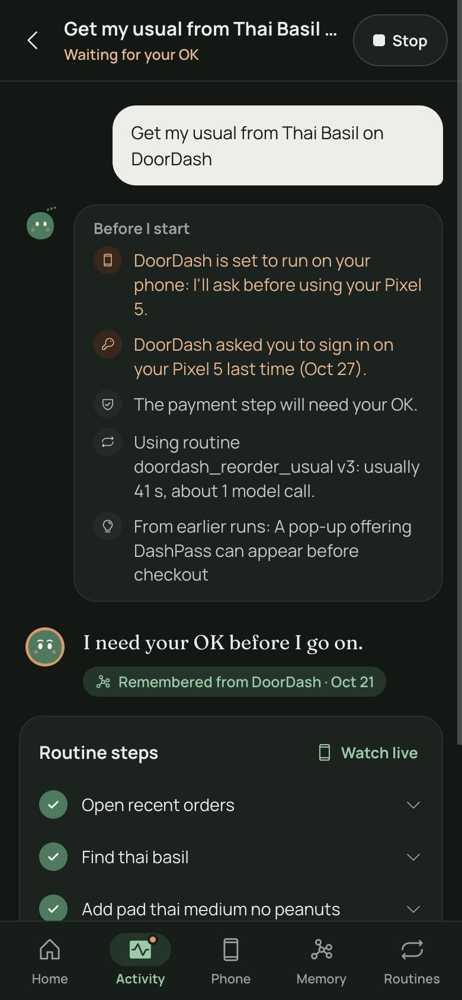
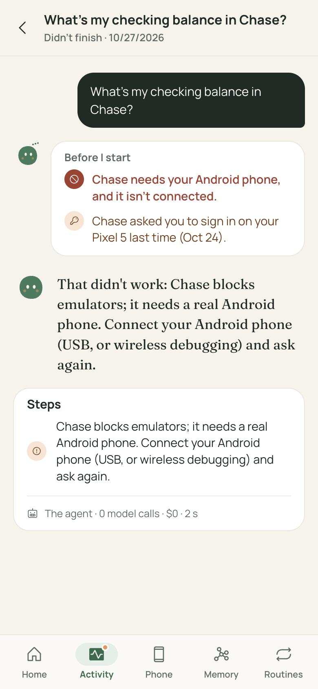
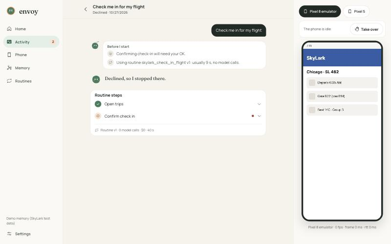
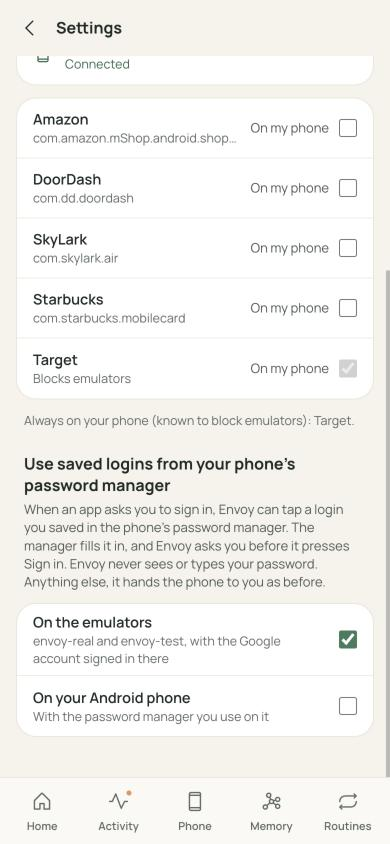
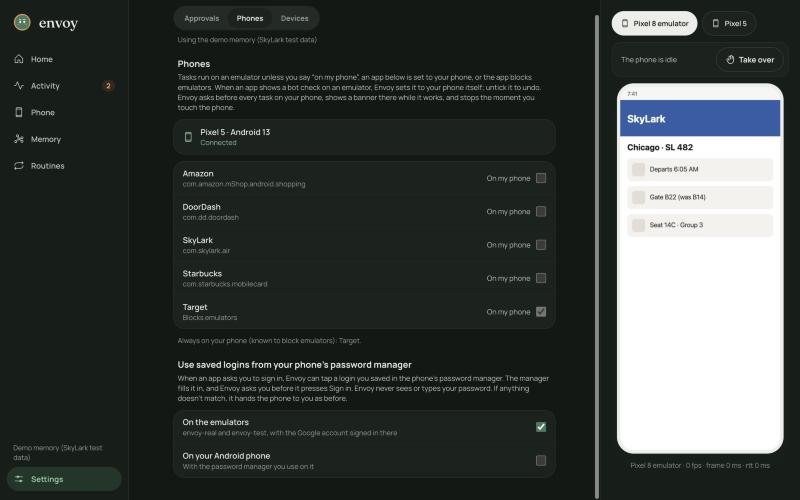
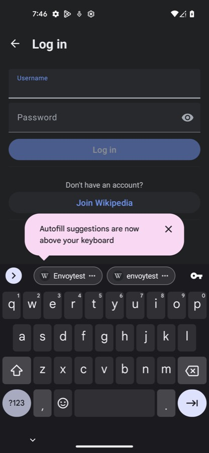

# preflight-logins: report

Branch `claude/bold-payne-71c942`, rebased on main `cf3872d`. Model spend: **$0**: nothing in this work calls the Meta API.

| Stage | State | Commits |
| --- | --- | --- |
| 0: `runner.start(..., phone_ok=)` and Instagram in `APP_NAMES` | **In main** (`823fbb8`, merged at `ce747cb`) | `823fbb8` |
| 1: Before I start | **In main** (`96b1699`) | `862b597`, `96b1699` |
| 2: saved logins (autofill) | Experiment done on envoy-real and the Pixel 5 (steps 2, 3 and 5 work on both; 3 after the coordinator's password-mask fix `beeeb5b`, which this experiment led to). **Feature built; ready after the Pixel check** (a captcha fix it found), off by default for both kinds of phone | `d08518b`, `7b44f3f`, `d8d269d`, `2404066`, the feature commit and the Pixel commit |

Tests: 591 backend tests pass on main `cf3872d` plus this branch (13 of them in `backend/tests/test_autofill.py`) (`uv run --project backend pytest backend/tests -q`), 23 of them in the new `backend/tests/test_preflight.py` (5 for stage 0, 18 for stage 1). `npm run build` in `web/` passes.

## Stage 0: the two runner changes others build on

- **`runner.start(..., phone_ok: str | None = None)`.** It records that your yes already covers that phone (`phone_allowed[task_id]`) right after the task is created, before its run is scheduled. `_choose_phone` then skips "Use your Pixel 5?" for that phone only; any other phone routing picks still asks. The entry is dropped when the task ends, so a yes never outlives its task (also when the task ran on an emulator).
- **Instagram in `APP_NAMES`.** Goals that name it resolve to `com.instagram.android`, and it shows in Settings › Phones and the approvals list. The only model input this changes is one more line in the cross-app lead's app catalog. Word-boundary matching, so "instagrammable" doesn't resolve.
- **Tests:** with `phone_ok` there's no second ask; without it the ask is unchanged; a `phone_ok` for another phone still asks; it's dropped on an emulator run; Instagram resolves and no other app moves. Each fails on the code before the change.

## Stage 1: Before I start

`backend/api/preflight.py`: `check(runner, goal, *, request, source, app, routine, inputs, phone, phone_ok=None)`. It returns at most five lines `{kind, text, level}`, stop first. It makes no model call and takes no device action, never raises, and takes 0.1–13 ms on a copy of the live history (under 6 ms on a test history of 5,000 tasks). The full contract, each line's source, and the rules behind each line are in `docs/preflight-and-autofill.md`.

**Real lines** (from a copy of the live task history and routine library):

```
Check me in for my flight to Chicago   (web, routine)
  warn  SkyLark asked you to sign in on envoy-test last time (Oct 28).
  info  Confirming check-in will go ahead: you asked for it.
  info  Using routine skylark_check_in_flight v1: usually 9 s, no model calls.
The same from Muse (mcp)
  info  Confirming check-in will wait for your OK.
Check the price of AirPods Pro at Target
  stop  Target needs your Android phone, and it isn't connected.     (no phone)
  warn  Target blocks emulators: I'll ask to use your Pixel 5.       (Pixel 5 connected)
Post the newest video … to Instagram as a reel   (mcp)
  info  Anything that can't be undone will wait for your OK.
In the Wikipedia app, look up Paris
  info  I haven't used Wikipedia on envoy-real before: if it isn't there, I'll install it from the Play Store (free apps only).
```

- **The runner** writes one `preflight` step per task right after planning: `{kind, text, lines}`. A task that moves to your phone keeps its one step, and a failing check leaves no step. It looks for phones once more only when a line is about your phone and none has been seen yet. An unconditional look shifted a background task's writes into `test_briefing`'s "nothing written" window, so the look is kept that narrow.
- **The evaluations:** I read every place in `eval/` and `backend/tests/` that reads task steps. Each filters by the kinds it cares about or logs every step, so a new kind changes no result.
- **The web:** a "Before I start" card at the top of the task view (`BeforeIStart`, exported for an offer's card), with the avatar thinking, warnings in apricot and a stop in brick. The step itself stays out of the step list. Mock fixtures cover a stop (Chase), sign-in and device warnings (DoorDash), a routine (check-in) and both streaming tasks.

Screenshots (mock mode):

| 390, dark: warnings and info | 390, light: a stop | 1440, light: a routine |
| --- | --- | --- |
|  |  |  |

**Contract additions** (told to the coordinator):
- `phone_ok=` is an optional extra keyword. With it, the device line says "I'll use your Pixel 5 (you said yes)" rather than promising an ask.
- `routine=` also takes a Routine object.

## Stage 2: saved logins, the experiment

The full write-up is in `docs/preflight-and-autofill.md`. The readings, redacted, are in `eval/results/autofill/2026-10-29/`.

- **Step 1** (read-only): envoy-real has Google's autofill and Google Password Manager. Its keyboard is the one Envoy types with (AdbKeyboard).
- **The setup:** a throwaway Wikipedia account, saved by the user signing in once in envoy-real's window and tapping Save. Google wanted a captcha-style check before it saved the password.
- **Step 2 works.** Focusing Username brings up Google's *"Use your saved password for Wikipedia?"* sheet. Envoy's ordinary screen reading lists it as numbered elements, with the password only as dots.
- **Step 3 works, after a fix.** One tap on the saved login (by Envoy, with the user's OK) filled both fields. But uiautomator2's dump held the **filled password in plain text**, and Envoy's screen layer put it in the field's label, and from there into the trace an agent writes at a sign-in screen. That was a gap in existing code. I reported it; the coordinator fixed it in main (`beeeb5b`, `mask_passwords()`) and found no past trace holding a password. Re-checked on the device with the field filled: Envoy now reads only `••••••••`.
- **Step 4 wasn't exercised:** neither window was marked secure.
- **Step 5 works.** The user pressed Log in, and it signed in.
- **Cleanup:**
  - Wikipedia was uninstalled. envoy-real's third-party apps before and after are the same 9: Amazon, Chipotle, DoorDash, Starbucks, Target, `com.github.uiautomator`, and Google's `contactkeys`, `safetycore` and `verifier`.
  - envoy-real was stopped with `stop_emulator.sh` and released. Nothing else was signed in or out.
- **The feature: built and held** (the coordinator's call, Oct 29):
  - `backend/api/autofill.py` and two hooks in `runner.py`'s sign-in branches.
  - `signin.autofill` is off by default, per phone kind; the Settings › Phones row is `web/components/SavedLogins.tsx`, plus one line in `Settings.tsx`.
  - It only taps. Every sign-in asks you through the normal approval, and the request's words can't approve it (a mutation check shows the test catches a named target).
  - 13 tests on the recorded screens. Details and the steps for a live run are in `docs/preflight-and-autofill.md`.
- **Also found and fixed:** `mask_passwords()` (`beeeb5b`) at first masked an *empty* password field too, because Material forms report its hint as its text. The coordinator fixed that in `53ab459`, and `autofill.filled()` now checks both fields.

| Saved logins setting, 390 light | 1440 dark |
| --- | --- |
|  |  |
- **Device time:** envoy-real 12:36–12:42 (step 1) and 12:48–13:30 (steps 2–5). Pixel 5 19:38–19:55.

## Stage 2 on the Pixel 5 (Oct 29, with the user)

**Read-only:**
- Android 13, with Google's autofill service.
- Gboard has inline suggestions on.
- The Google account is envoy3955, the same as envoy-real, so the throwaway login was already saved.

**What the Pixel showed** (full table in `docs/preflight-and-autofill.md`, "The Pixel 5"):
- **The same sheet as envoy-real,** not a keyboard strip: "Use your saved password for Wikipedia?". The held feature's finder read it live.
- **The sheet shows once.** Once it's dismissed, the login moves to Gboard chips, which aren't in the accessibility tree. The feature's code said there was no saved login and handed the phone back, which is correct.
- **The first fill showed a one-time consent screen,** Google's "Autofill with Google" with Continue. The user accepted it (it's theirs to accept), and the feature handed the phone back, which is correct. After Continue both fields filled, and Envoy reads the password only as dots: the mask holds on the Pixel.
- **Log in brought an hCaptcha.** With it up, the sign-in check reads "not a sign-in", so the held feature would have reported "Signed in". **Fixed:** after the button it settles and checks `bot_check_reason()`, and a captcha hands the phone back. There's a test on the recorded Pixel screen; it fails without the fix.

**Cleanup:**
- Wikipedia was uninstalled, and the 3 third-party apps match before and after.
- Instagram is still signed in, and nothing was signed out.
- The Pixel was released for muse-link at 19:55.

**Decision:** the branch is ready, off by default for both kinds of phone. The Pixel matches envoy-real in shape; it added one fix (the captcha) and two hand-offs that are correct as built.

| Gboard's chips after the sheet closed (not in the tree) |
| --- |
|  |

## Not done or not checked

- **No device run end to end yet.** The whole feature through the runner (approval and button) hasn't run on a device; its parts have, on both. A live run on the throwaway account is in the doc, for the user to do or OK. The throwaway login stays in envoy3955's Google Password Manager until then; the user deletes it afterwards.
- **The consent screen and the Gboard chips** end in a hand-off with a general note ("didn't fill", "offered no saved login"). Naming them more precisely is possible but not built.
- Using the card's lines on an offer's card and in MCP's `heads_up` is for proactive and muse-link, through their guarded imports.
- I haven't seen the card live on the iPhone (:8443). It's checked in mock mode at 390 and 1440 only. The live API restarts on the new build only after the coordinator merges.
- `memory/retrieval.py` names apps for memory answers from its own short list, so Instagram would show there as "android app". That's memory's lane, not changed here.
