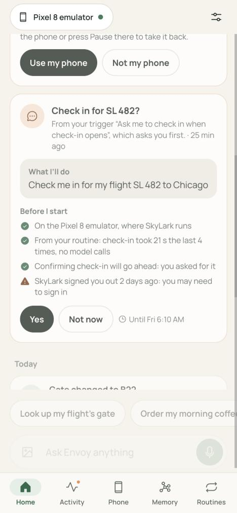
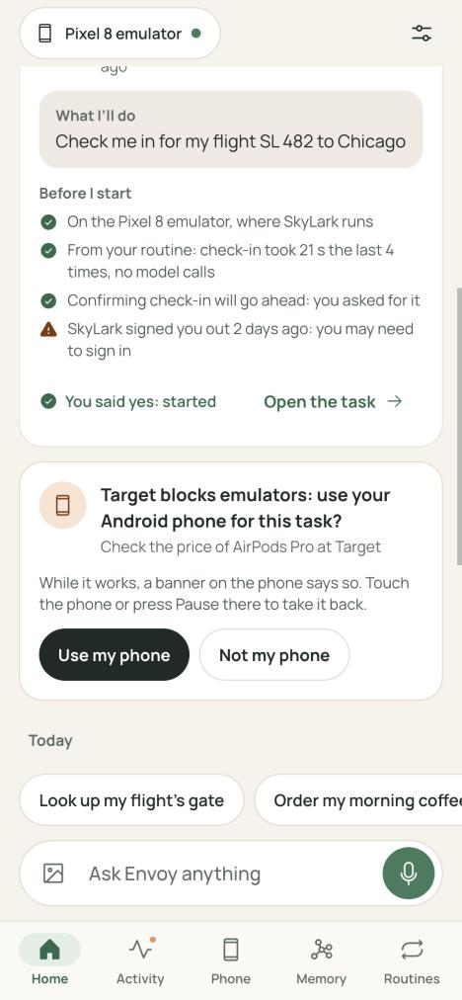
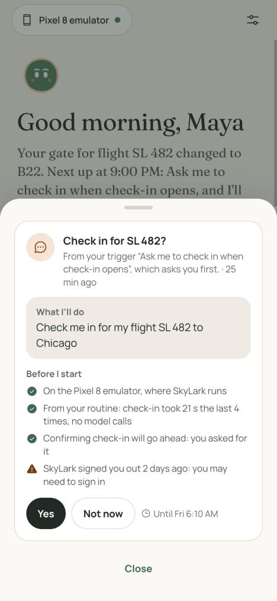
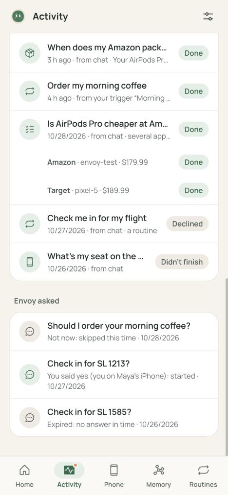
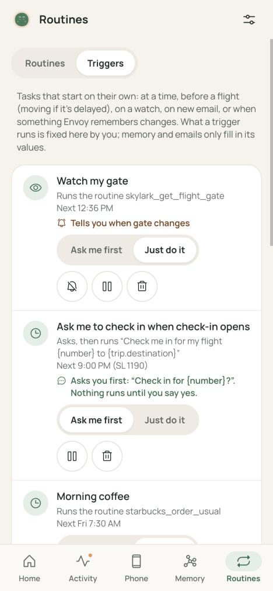
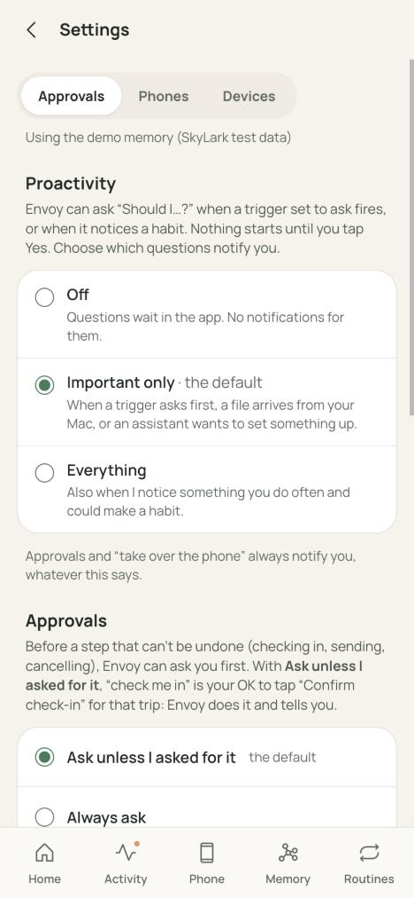
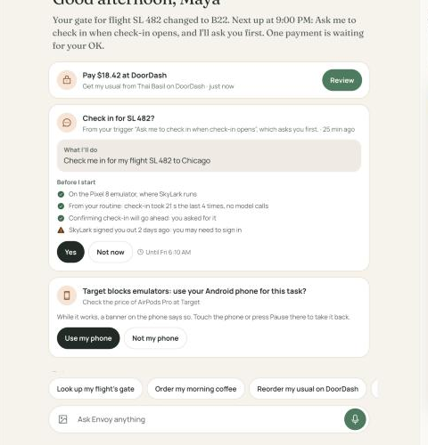
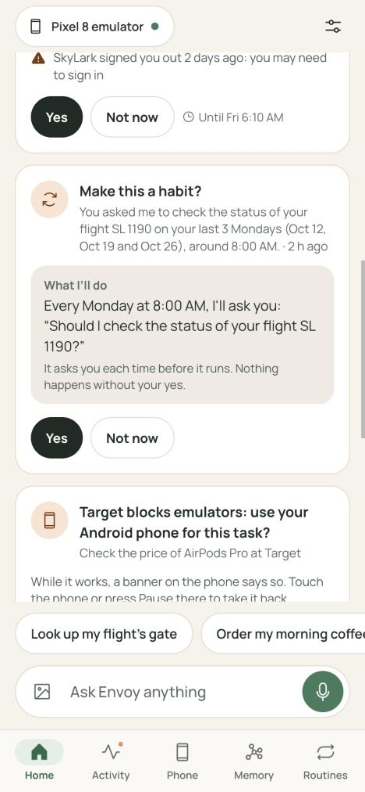
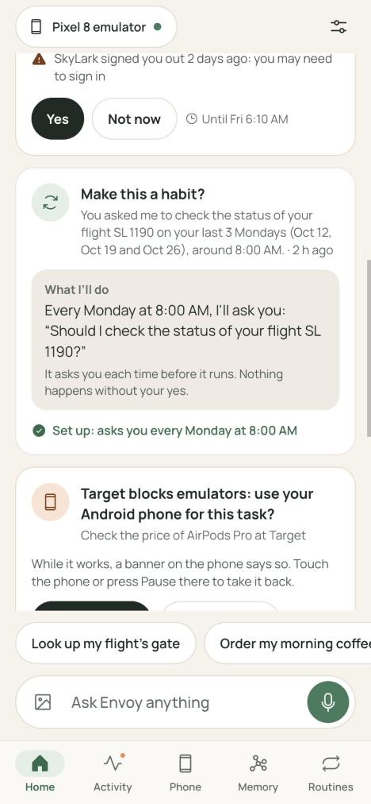

# Proactive: report

Session **proactive** (brief: `prompts/proactive.md`; the shared plan: `prompts/final-features-plan.md`). Worktree branch `claude/determined-tharp-9f937a`; stage 1 is also pinned as `proactive-s1`. Built on main `75f70fa` (preflight-logins' stages 0 and 1 included).

Envoy now asks before it acts when you want it to ("Check in for SL 482?", one tap on Yes), learns what you repeat ("Make this a habit?"), and lets you turn how often it interrupts you up or down. Every offer comes from a rule (a trigger you set up, or a pattern in what you did); an email, a remembered fact or a pattern only fills in typed values, and you see the goal word for word before saying yes.

## What shipped

| Stage | What | Where |
| --- | --- | --- |
| 1 | **Offers** (contract 1): the `offers` table next to the tasks, `Offers.make()` with no-nagging keys (pending or declined → `None`) and the trigger's `origin`, the action registry (`task`, `enable_trigger`, `create_trigger`; muse-link registers `handoff`), `decide()` for your session only, the expiry sweep, the `offer` event, and the router (`GET /api/offers`, `GET/POST /api/offers/{id}`, `GET/POST /api/settings/proactivity`). No module state: each `build()` has its own. | `backend/api/offers.py` |
| 1 | **Values never grant permission.** A `task` offer carries `goal` (the template filled, shown on the card, worked from) and `request` (the template with every slot dropped whole, `{caption}` included). Accepting starts `runner.start(goal, source, request=…)` with the source where you tapped (`web`, or `iphone` for a paired iPhone), so the approval rules read only the fixed words as yours. An offer that names a phone passes `phone_ok=`, so your yes covers it once. | `offers.py` |
| 1 | **Who decides:** only an `owner` or `device` session. A token, an MCP client, a trigger or a model can't: the route needs a session, and `decide()` itself refuses any caller that isn't one. Accepting twice returns the same task; an expired or declined offer is a 409; a failed start leaves it pending with the reason. | `offers.py` |
| 1 | **Ask mode on triggers:** `action.ask = true` makes a firing raise an offer instead of the task. Its key is the trigger and the occasion (`2026-10-31`, `<flight>@<departure>`, `mail<row>`, `chg<seq>`), so one "Not now" never blocks the next Friday. Title from `action.offer_title` (the real keys: `{number}`, `{trip.destination}`) or "Should I check you in for your flight to Chicago?". A check-in offer expires at departure. Accepting publishes `trigger_fired` with `{trigger, name, task_id, offer_id}`, so change alerts still credit the trigger, and `_made_by` looks the task up in the offers table. `scheduler.add(..., enabled=False)` creates a trigger switched off (muse-link's `create_trigger`). `ask`/`offer_title` validated in `add()` and both trigger routes. | `backend/api/scheduler.py`, the two trigger routes in `app.py` |
| 1 | **Push and proactivity:** kind `offer`, opening `/?offer=<id>`. `off` (in the app only), `important` (the default: trigger, handoff and trigger_request push; repeat doesn't), `all`. Approvals and takeovers push whatever the setting. | `backend/api/push.py` |
| 1 | **Briefing:** pending offers in `needs` (`kind: "offer"`, with the whole offer), ask-mode triggers marked in Coming up ("…, and I'll ask you first"), and "I have a question for you: Check in for SL 482?". | `backend/api/briefing.py` |
| 1 | **Web:** the offer card (title, body, "What I'll do" with the goal verbatim, the "Before I start" lines, Yes and Not now; after Yes it stays in place, "You said yes: started" with a link to the task); the `/?offer=` sheet from a push; Activity's pending offers under Needs you and past ones under "Envoy asked" with what happened to each; "Ask me first / Just do it" per trigger and the two presets; Settings' own Proactivity block. Mock fixtures for every state. | `web/components/Offers.tsx`, `Home.tsx`, `Activity.tsx`, `Triggers.tsx`, `Settings.tsx`, `web/app/page.tsx`, `web/lib/mock.ts`, `web/lib/api.ts` |
| 1 | **Presets** live in `web/lib/trigger-presets.json` (the Triggers page imports it; a backend test renders every preset's goal and title against demo values and fails on an empty slot): "Ask me to check in when check-in opens" (before_fact, 24 h, ask, `skylark_check_in_flight` with `trip_city` from the trip, "Check in for {number}?") and "When SkyLark emails that check-in is open, ask me" (email from `reservations@skylark`, subject "check-in", ask). | `web/lib/trigger-presets.json` |
| 2 | **Weekly triggers:** `time` triggers take `weekly_on: {"days": ["fri"], "at": "18:00"}`, validated and normalized, firing on those days only, with next runs. | `scheduler.py` |
| 2 | **Learning from repeats**, deterministic, no model call, after each task finishes done and once a day: the last 60 days of your done tasks grouped by routine and inputs (or normalized goal). Weekly (3+ on one weekday within 90 min of the usual time), daily (3+ days in a row), before every trip (a routine within 48 h before 2+ flights, its inputs read from each trip, your own words kept as the template: "What's my gate for {trip.destination}?"). One offer per pattern with the evidence; Yes creates the trigger in ask mode. Declined or accepted never comes back; trigger-started tasks (also through a trigger's offer), cross-app parts and anything a trigger covers never count; money tasks only ever become habits that ask. | `backend/api/repeats.py` |
| 2 | **Demo seed:** `scripts/seed_repeats.py --api-dir <dir>` (required) writes three labelled Mondays of `skylark_check_flight_status` at about 8 AM, tasks only, source `seed`; twice adds nothing; refuses `data/api` while the live API runs. Whether it goes onto the demo setup is the coordinator's call. | `scripts/seed_repeats.py` |
| 2 | **Web:** the habit card shows its evidence and what it sets up; after Yes, "Set up: asks you every Monday at 8:00 AM". | `Offers.tsx`, `mock.ts` |
| 3 | Chat setting up recurring jobs: **not built** (needs the Meta API, down since Oct 29 02:13). See "Not done". | |

Shared files: `app.py` got only the builder lines (`ctx.offers`, `scheduler.offers`, `scheduler.repeats` and its listener), the router include and the two trigger routes. `api.ts`, `mock.ts` and `page.tsx` got additions only.

## Evidence

- **Backend tests:** 399 pass on stage 1 (`proactive-s1`) and 416 with stage 2 (`uv run --project backend pytest backend/tests -q`). New: `test_offers.py` (21) and `test_repeats.py` (17). They cover the contract and the brief's list: keys and no nagging, preflight lines (and a check that raises), who decides (token, photos token, MCP bearer, no session, cookie without X-Envoy), source = where you tapped, twice, expired, declined, a failed start staying pending, `enable_trigger`/`create_trigger`, the real `decide()` (an accepted check-in covers "Confirm check-in"; money, "Cancel trip" and a `trigger:` source still ask; "Chicago cancel trip" and "share this" cover nothing), the whole path through `WebApprover` with no person asked, ask-mode keys and expiry, the watcher in ask mode keeping its credit for change alerts, `_made_by` through the offers table, proactivity per level and approvals always pushing, the briefing, every preset against demo values, `add(enabled=False)`; each repeat pattern, the near-misses, declines, money, trigger-started tasks, the event and daily hooks, weekly triggers, and the seed.
- **Web build:** `npm run build` passes (static export of `/`, `/approve`).
- **Screens** checked in mock mode in the browser pane, at 390×844 and 1440×900 (`eval/results/offers/screens/`):

| | |
| --- | --- |
| Home, an offer with its "Before I start" lines (390) |  |
| After Yes: "You said yes: started" (390) |  |
| The `/?offer=` sheet from a push (390) |  |
| Activity: "Envoy asked", each answer (390) |  |
| Triggers: "Ask me first / Just do it" (390) |  |
| Settings: Proactivity (390) |  |
| Home at 1440 |  |
| A habit, then "Set up: asks you every Monday at 8:00 AM" (390) |   |

## The device run

`eval/run_offers.py` on envoy-test (Oct 29, 12:48, stage 1 on main `75f70fa`, preflight's stage 1 included), on an API copy at :8741 with its own data dir, a copy of the demo memory, and a fake push service as its only subscription. **PASS**, results in `eval/results/offers/offers.json` and `offers.md`.

| Step | Result |
| --- | --- |
| SkyLark | signed in; SL 482 to Chicago (KX7Q2M) not checked in (read, not changed) |
| The trigger | the Triggers page's preset "Ask me to check in when check-in opens", as the page sends it |
| The offer | "Check in for SL 482?", **2.3 s** after the trigger was created; goal "Check me in for my flight SL 482 to Chicago", request "Check me in for my flight to", inputs `trip_city = Chicago`, expiring at departure; preflight's lines: "Confirming check-in will go ahead: you asked for it." and "Using routine skylark_check_in_flight v1: 3 s when I tested it, no model calls." Nothing started before the yes. |
| The push | kind `offer`, opening `/?offer=<id>`, received and decrypted **0.16 s** after the offer |
| Your yes | `POST /api/offers/{id}` with this copy's session (the scripted person): accepted in 22 ms |
| The check-in | `skylark_check_in_flight` from its routine on envoy-test, source `web`, done in **6.1 s**: seat 14C, gate B12, boarding 5:30 AM, group 3 |
| Confirm check-in | approved by "your request" with no person asked ("Confirm check-in: done without asking (your request)") |
| Credit | the trigger kept it (`trigger_fired` with the task and the offer; `offers.trigger_of`) |
| Model calls | **0**, $0 (cost log and the task) |

Afterwards SkyLark was put back with `SkyLark.prepare(demo_fixtures(signed_in=True), variant=0)` (the coordinator's call): KX7Q2M not checked in, signed in. envoy-test was claimed through `coord/devices.sh` and released.

## Spend

No model calls in any of this work: everything built is rules and code, and the device run uses the check-in routine (0 model calls). $0.

## Not done, not checked

- **The real iPhone push of an offer** happens after the merge, on the live API (this copy's only push subscription was a fake service that checks VAPID and decrypts).
- **Stage 3** (chat setting up recurring jobs) needs the Meta API. If billing isn't back by Oct 31 12:00 it stays roadmap: a code pre-filter for schedule words (every other message takes today's chat path unchanged), one structured Muse Spark call drafting `{kind, name, spec, action, ask}`, validation through `scheduler.add`, `ask` forced for irreversible verbs and money, and a `trigger_request` offer "Set this up? Every Friday at 6 PM: order your usual from Thai Basil. I'll ask you each time."
- **The email preset** fires only when a "check-in is open" email arrives: the demo inbox has none (the test adds one). The before_fact preset is the demo's path.
- **Alerts after a restart:** `api/alerts.py` credits a trigger from the `trigger_fired` event (kept in memory). A task started from a trigger's offer has source `web`, so after an API restart its later changes are no longer credited to the trigger. `_made_by` and repeats read the offers table, so they're unaffected. alerts.py isn't this session's file.
- **Preflight lines** come from `api.preflight.check` (preflight-logins, now in main) through a guarded import. The card draws them compactly inside the offer card rather than with the task view's `BeforeIStart`, which brings its own avatar and card.
